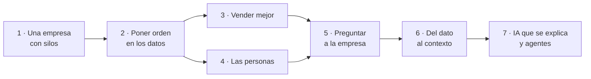

# FraSoHome · demos

**FraSoHome** es una cadena ficticia de muebles y decoración para el hogar que vende en tiendas físicas y por internet. Tiene CRM, TPV, ecommerce, almacén, campañas de marketing, una base documental interna y una plantilla de unas 670 personas en activo. Y tiene el problema que tienen casi todas las empresas reales: **muchos datos y ninguna visión única del negocio**.

Este repositorio cuenta la historia de FraSoHome y reúne, en un solo sitio, todo lo necesario para ejecutar cada una de sus demos: la narrativa, los datos, los notebooks, los scripts, los laboratorios y las guías de instructor.

> Todos los datos son **sintéticos** y contienen **errores de calidad intencionados**. No representan a ninguna empresa real.

## Cómo está organizado

| Carpeta | Qué contiene |
| --- | --- |
| [historia](historia/README.md) | La empresa, su problema, su universo de datos y los capítulos de la historia. |
| [escenarios](escenarios/README.md) | Diez demos. Cada una tiene una ficha con audiencia, duración, recursos necesarios y pasos para ejecutarla. |
| [datos](datos/README.md) | Los datos originales en CSV, los documentos de la base de conocimiento y las tablas puente entre dominios. |
| [docencia](docencia/README.md) | Temarios, ebooks y propuestas de sesión construidos sobre el caso. |
| [presentaciones](presentaciones/README.md) | Guiones de presentación para introducir el caso. |
| [diagramas](diagramas/README.md) | Diagramas editables en draw.io. |

[De dónde sale este material y qué ha cambiado respecto al original](ORIGEN.md).

## La historia en siete capítulos



| Capítulo | Escenarios |
| --- | --- |
| 1 · Una empresa con datos pero sin visión única | [01 · La empresa con silos](escenarios/01-empresa-con-silos/README.md) |
| 2 · Poner orden en los datos | [02 · Fabric: del CSV a la fact table](escenarios/02-fabric-preparacion-datos/README.md) · [03 · SQL Raw → Core → Analytics](escenarios/03-sql-raw-core-analytics/README.md) |
| 3 · Vender mejor, no solo vender más | [04 · Analítica de ventas y ML](escenarios/04-analitica-ventas-ml/README.md) · [05 · Marketing de precisión](escenarios/05-marketing-precision/README.md) |
| 4 · Las personas detrás de la tienda | [06 · People Analytics con Power BI](escenarios/06-power-bi-people-analytics/README.md) |
| 5 · Preguntar a la empresa | [07 · Asistente RAG con Copilot Studio](escenarios/07-copilot-studio-rag/README.md) |
| 6 · Del dato al contexto | [08 · Fabric IQ: ontología, grafo y agente](escenarios/08-fabric-iq-ontologia/README.md) |
| 7 · IA que se explica y agentes | [09 · Interpretabilidad GenAI](escenarios/09-genai-interpretabilidad/README.md) · [10 · Agentes con Foundry](escenarios/10-agentes-foundry/README.md) |

## Por dónde empezar

- **Vas a presentar el caso**: lee [la historia](historia/README.md) y usa el [escenario 01](escenarios/01-empresa-con-silos/README.md).
- **Buscas una demo concreta**: el [catálogo de escenarios](escenarios/README.md) las filtra por audiencia, tecnología y duración.
- **Necesitas los datos**: el [catálogo de datos](datos/README.md) describe cada CSV y cómo se relacionan.

## Ejecutar el sitio en local

El repositorio se publica con [MkDocs Material](https://squidfunk.github.io/mkdocs-material/). Para verlo en tu equipo:

```bash
pip install -r requirements-docs.txt
mkdocs serve
```

El flujo `.github/workflows/docs.yml` lo publica en GitHub Pages en cada push a `main`. En **Settings → Pages**, el origen debe ser **GitHub Actions**.

## Licencia

[MIT](https://github.com/antoniosql/frasohome-demos/blob/main/LICENSE). Autor: Antonio Soto.
