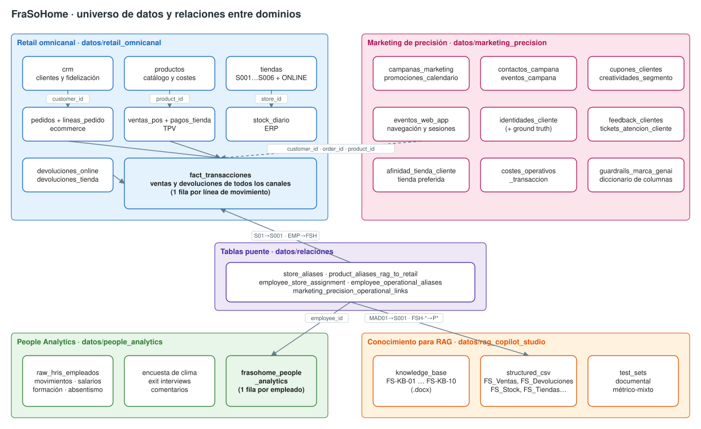
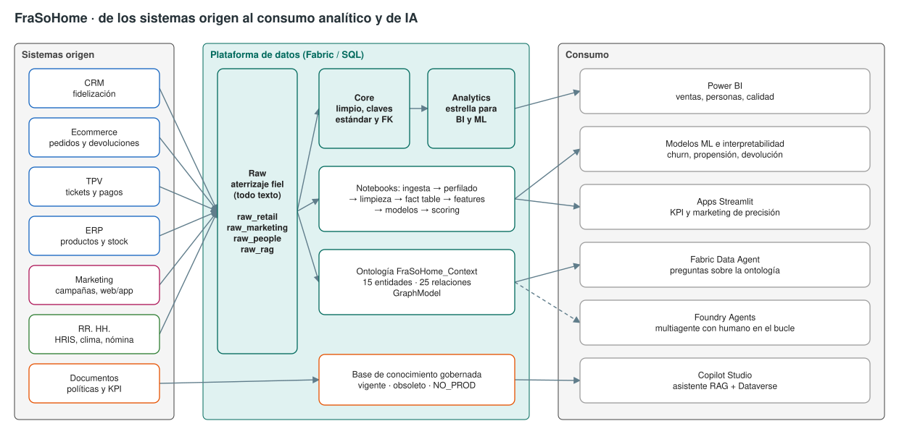
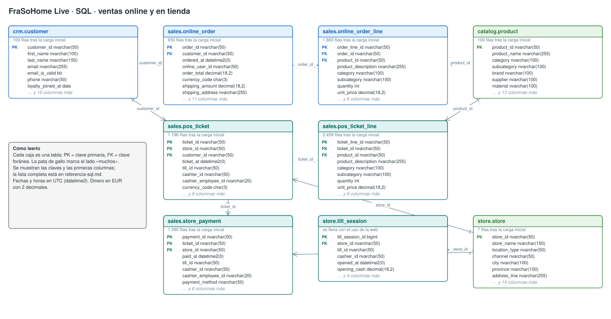
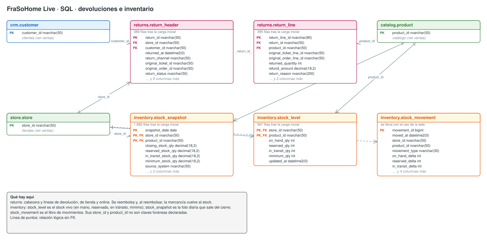
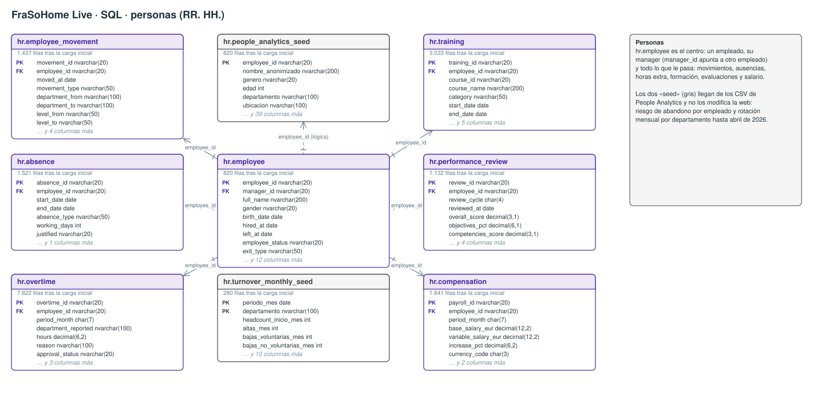
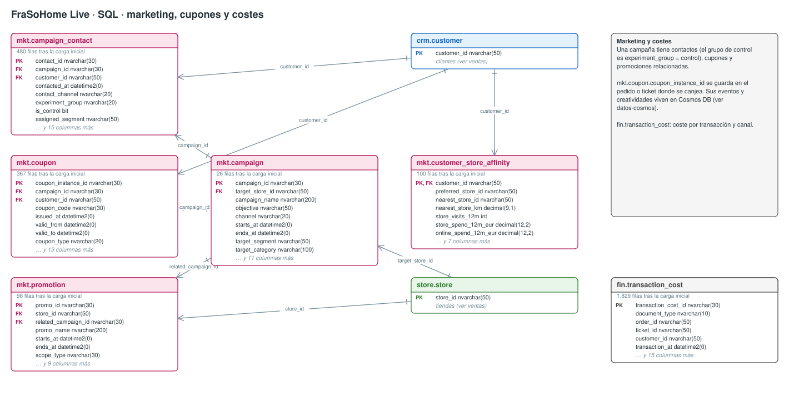
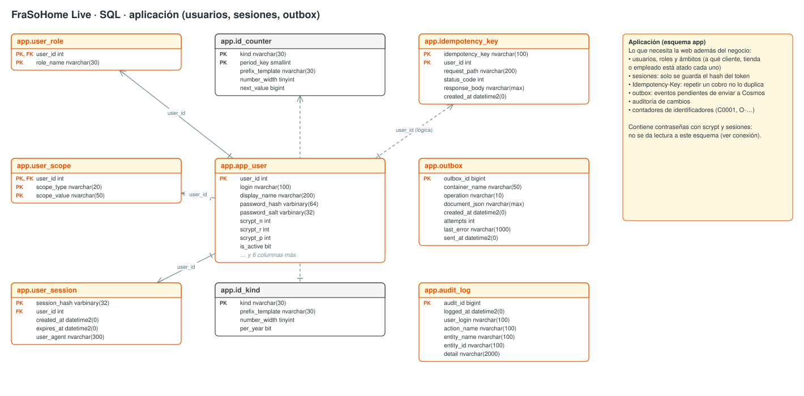
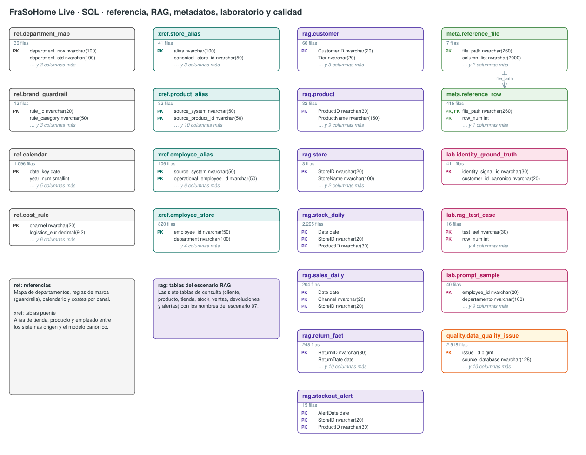
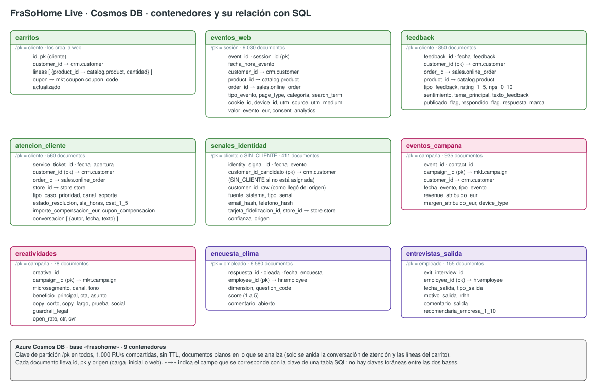
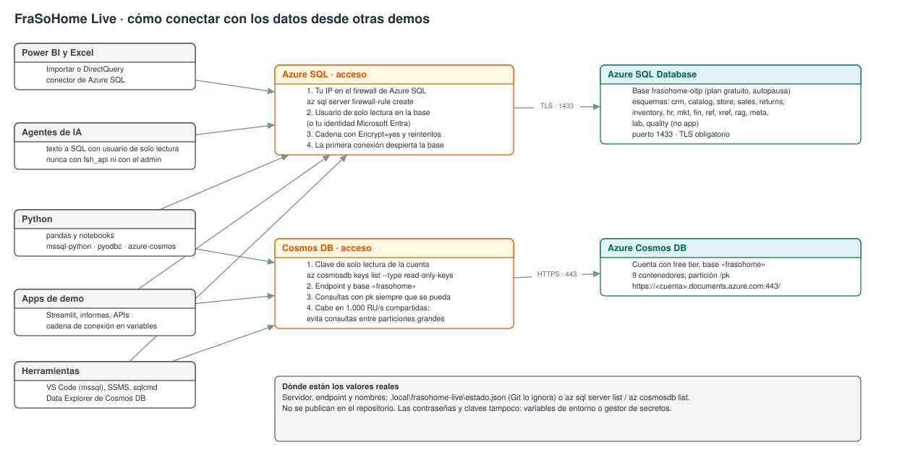

# Diagramas

Diagramas del caso en formato draw.io. Cada diagrama existe en dos ficheros con el mismo contenido:

- **`.drawio.svg`**: se ve directamente en GitHub y en el sitio, y se puede editar en [diagrams.net](https://app.diagrams.net) o con la extensión *Draw.io Integration* de VS Code (el diagrama editable va incrustado en el SVG).
- **`.drawio`**: el XML de draw.io, para quien prefiera el formato nativo.

| Diagrama | Ficheros | Dónde se usa |
| --- | --- | --- |
| Universo de datos y relaciones entre dominios | [`universo-datos.drawio.svg`](universo-datos.drawio.svg) · [`universo-datos.drawio`](universo-datos.drawio) | [Universo de datos](../historia/universo-de-datos.md) |
| De los sistemas origen al consumo analítico y de IA | [`arquitectura-datos.drawio.svg`](arquitectura-datos.drawio.svg) · [`arquitectura-datos.drawio`](arquitectura-datos.drawio) | [Universo de datos](../historia/universo-de-datos.md) |
| Capítulos de la historia y escenarios | [`mapa-escenarios.drawio.svg`](mapa-escenarios.drawio.svg) · [`mapa-escenarios.drawio`](mapa-escenarios.drawio) | [Escenarios](../escenarios/README.md) |
| Arquitectura de FraSoHome Live (web transaccional) | [`arquitectura-web-transaccional.drawio.svg`](arquitectura-web-transaccional.drawio.svg) · [`arquitectura-web-transaccional.drawio`](arquitectura-web-transaccional.drawio) | [Escenario 11](../escenarios/11-web-transaccional/README.md) |
| Datos SQL · ventas online y en tienda | [`datos-sql-ventas.drawio.svg`](datos-sql-ventas.drawio.svg) · [`datos-sql-ventas.drawio`](datos-sql-ventas.drawio) | [Datos en vivo](../escenarios/11-web-transaccional/datos-en-vivo.md) |
| Datos SQL · devoluciones e inventario | [`datos-sql-devoluciones-inventario.drawio.svg`](datos-sql-devoluciones-inventario.drawio.svg) · [`datos-sql-devoluciones-inventario.drawio`](datos-sql-devoluciones-inventario.drawio) | [Datos en vivo](../escenarios/11-web-transaccional/datos-en-vivo.md) |
| Datos SQL · personas | [`datos-sql-personas.drawio.svg`](datos-sql-personas.drawio.svg) · [`datos-sql-personas.drawio`](datos-sql-personas.drawio) | [Datos en vivo](../escenarios/11-web-transaccional/datos-en-vivo.md) |
| Datos SQL · marketing, cupones y costes | [`datos-sql-marketing.drawio.svg`](datos-sql-marketing.drawio.svg) · [`datos-sql-marketing.drawio`](datos-sql-marketing.drawio) | [Datos en vivo](../escenarios/11-web-transaccional/datos-en-vivo.md) |
| Datos SQL · aplicación | [`datos-sql-aplicacion.drawio.svg`](datos-sql-aplicacion.drawio.svg) · [`datos-sql-aplicacion.drawio`](datos-sql-aplicacion.drawio) | [Datos en vivo](../escenarios/11-web-transaccional/datos-en-vivo.md) |
| Datos SQL · referencia, RAG, metadatos y laboratorio | [`datos-sql-referencia.drawio.svg`](datos-sql-referencia.drawio.svg) · [`datos-sql-referencia.drawio`](datos-sql-referencia.drawio) | [Datos en vivo](../escenarios/11-web-transaccional/datos-en-vivo.md) |
| Datos Cosmos DB · contenedores | [`datos-cosmos.drawio.svg`](datos-cosmos.drawio.svg) · [`datos-cosmos.drawio`](datos-cosmos.drawio) | [Datos en vivo](../escenarios/11-web-transaccional/datos-en-vivo.md) |
| Cómo conectar con los datos de FraSoHome Live | [`datos-conexion.drawio.svg`](datos-conexion.drawio.svg) · [`datos-conexion.drawio`](datos-conexion.drawio) | [Datos en vivo](../escenarios/11-web-transaccional/datos-en-vivo.md) |

## Universo de datos

## Arquitectura

## Mapa de escenarios

## Web transaccional

## Modelo de datos (SQL)

Las tablas de Azure SQL de FraSoHome Live, agrupadas por dominio. Las columnas completas están en la [referencia del esquema](../escenarios/11-web-transaccional/referencia-sql.md).

## Modelo de datos (Cosmos DB)

## Cómo conectar con los datos

Si editas un `.drawio.svg` en diagrams.net, guárdalo con el mismo nombre para que las páginas sigan mostrándolo. Si editas el `.drawio`, exporta también el `.drawio.svg` (Archivo → Exportar como → SVG, con "Incluir copia del diagrama").
