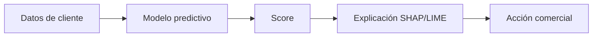
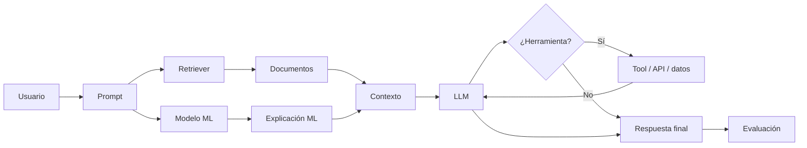
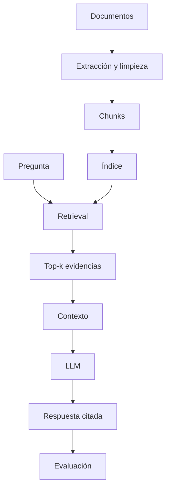
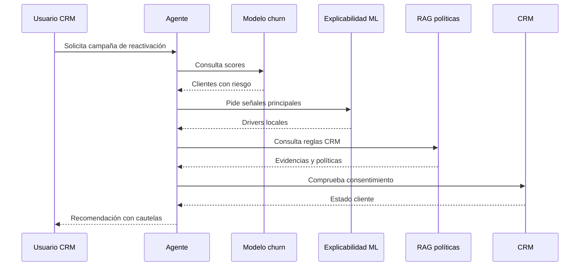
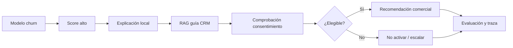

# Interpretabilidad y evaluación de LLM, RAG y agentes

## Ebook narrativo aplicado al caso FraSoHome

### Máster Big Data · IFFE

---

## Índice

1. [Por qué la interpretabilidad cambia cuando pasamos a GenAI](#1-por-qué-la-interpretabilidad-cambia-cuando-pasamos-a-genai)
2. [De explicar un score a explicar un sistema](#2-de-explicar-un-score-a-explicar-un-sistema)
3. [Qué podemos y qué no podemos explicar de un LLM](#3-qué-podemos-y-qué-no-podemos-explicar-de-un-llm)
4. [El contexto como primera unidad de explicabilidad](#4-el-contexto-como-primera-unidad-de-explicabilidad)
5. [RAG explicable: responder con evidencia](#5-rag-explicable-responder-con-evidencia)
6. [Evaluación de RAG: separar recuperación, generación y utilidad](#6-evaluación-de-rag-separar-recuperación-generación-y-utilidad)
7. [Agentes: cuando la IA no solo responde, sino que decide pasos](#7-agentes-cuando-la-ia-no-solo-responde-sino-que-decide-pasos)
8. [Evaluación de agentes y trazabilidad de extremo a extremo](#8-evaluación-de-agentes-y-trazabilidad-de-extremo-a-extremo)
9. [Rúbricas, métricas y gobierno de soluciones GenAI](#9-rúbricas-métricas-y-gobierno-de-soluciones-genai)
10. [Caso integrado FraSoHome: de churn a agente comercial](#10-caso-integrado-frasohome-de-churn-a-agente-comercial)
11. [Guía práctica para diseñar una evaluación GenAI](#11-guía-práctica-para-diseñar-una-evaluación-genai)
12. [Cierre: cinco preguntas antes de poner GenAI en producción](#12-cierre-cinco-preguntas-antes-de-poner-genai-en-producción)

---

# 1. Por qué la interpretabilidad cambia cuando pasamos a GenAI

En las sesiones anteriores de FraSoHome, la interpretabilidad se ha construido alrededor de modelos predictivos relativamente clásicos. Teníamos un dataset tabular, una etiqueta, un modelo entrenado y una predicción. Por ejemplo, un cliente podía recibir un score alto de inactividad, una campaña podía tener una probabilidad estimada de conversión, o una línea de pedido podía tener cierto riesgo de devolución.

En ese mundo, interpretar significaba responder a preguntas como:

- ¿Qué variables explican globalmente el comportamiento del modelo?
- ¿Por qué este cliente concreto tiene un score tan alto?
- ¿Cómo cambia la predicción cuando aumenta la recencia o la frecuencia?
- ¿Qué variables son importantes, pero no necesariamente accionables?
- ¿Qué explicación puede entender marketing, CRM, operaciones o dirección?

Técnicas como permutation importance, PDP, ICE, SHAP o LIME encajan bien en ese escenario porque el objeto de explicación está bastante delimitado: una fila de datos entra en un modelo y sale una predicción.

Con GenAI, el terreno cambia.

Un asistente basado en LLM no suele limitarse a emitir un score. Recibe una pregunta, interpreta una intención, puede recuperar documentos, puede consultar datos, puede llamar a herramientas, puede sintetizar información y puede proponer una acción. La salida ya no es solo una probabilidad; puede ser una respuesta redactada, una recomendación comercial, una tabla, un plan, un borrador de email o una decisión de escalar a una persona.

Esto obliga a cambiar la pregunta.

Ya no basta con preguntar:

> ¿Por qué el modelo predijo esto?

Ahora hay que preguntar:

> ¿Qué ha visto el sistema, qué ha recuperado, qué pasos ha seguido, qué ha generado, qué evidencias lo respaldan y cómo sabemos que la respuesta es fiable?

Esta diferencia es crucial. Una solución GenAI puede fallar aunque el LLM sea muy potente. Puede fallar porque recupera el documento equivocado, porque usa una política obsoleta, porque omite una condición, porque cita una fuente que no respalda la respuesta, porque interpreta mal una pregunta ambigua, porque llama a una herramienta con parámetros erróneos o porque actúa sin comprobar permisos.

En otras palabras: en GenAI, la interpretabilidad deja de ser solo una propiedad del modelo y pasa a ser una propiedad del **sistema completo**.

## FraSoHome como hilo conductor

FraSoHome es un buen caso para entender este salto porque ya tenemos varias piezas del sistema:

- Datos operativos de ventas, CRM, campañas, pedidos, devoluciones, productos y tiendas.
- Modelos predictivos de inactividad y propensión.
- Explicaciones locales y globales de esos modelos.
- Documentos de conocimiento: políticas de devolución, guías de fidelización, diccionarios KPI, manuales de tienda y normas de seguridad.
- Demos de RAG y agentes.

Imaginemos que FraSoHome quiere desplegar un asistente para el equipo de CRM. Un usuario podría preguntarle:

> “¿A qué clientes Platino debería lanzar una campaña de reactivación y qué mensaje sería razonable?”

Una respuesta ingenua podría ser:

> “Lanza un descuento del 30 % a los clientes con mayor riesgo de abandono.”

Suena directa, pero es mala. No sabemos qué datos ha usado, no sabemos si hay consentimiento de marketing, no sabemos si el descuento respeta margen, no sabemos si hay política de presión comercial, no sabemos si el cliente está bloqueado, y no sabemos si el score de churn se está interpretando como causalidad.

Una respuesta explicable sería diferente:

> “El cliente tiene un score alto de inactividad según el modelo predictivo. Las señales principales son recencia elevada, menor frecuencia reciente y margen histórico relevante. Antes de activar una campaña, debe comprobarse consentimiento de marketing, estado del cliente y presión comercial reciente. Si el cliente es elegible, se recomienda una acción de reactivación con incentivo moderado, vinculada a su categoría de compra dominante y no necesariamente un descuento agresivo. La recomendación se apoya en la guía CRM y debe validarse con medición incremental.”

La diferencia no está solo en la redacción. La segunda respuesta separa dato, predicción, explicación, evidencia documental, cautela y acción.

Ese es el estándar que buscamos.

---

# 2. De explicar un score a explicar un sistema

En ML tabular, el flujo de explicación suele ser lineal:



Este flujo sigue siendo útil. De hecho, en FraSoHome lo necesitamos. Pero en una solución GenAI real, ese flujo se integra dentro de otro más amplio:



Este diagrama muestra algo fundamental: el LLM no está solo. La respuesta final puede depender de:

- La pregunta del usuario.
- El prompt del sistema.
- El historial de conversación.
- Los documentos recuperados.
- Los scores de modelos predictivos.
- Las explicaciones de esos modelos.
- Las herramientas disponibles.
- Los permisos del usuario.
- Los guardrails de seguridad.
- Los parámetros de generación.

Por eso, cuando hablamos de interpretabilidad en LLM, conviene distinguir cuatro conceptos.

## Interpretabilidad

La interpretabilidad se refiere a la capacidad de comprender cómo funciona un modelo o cómo ciertas entradas influyen en sus salidas.

En modelos lineales, árboles o reglas, la interpretabilidad puede ser relativamente directa. En modelos complejos, usamos técnicas aproximadas. En LLM, la interpretabilidad interna completa es mucho más difícil porque hablamos de modelos enormes, con miles de millones de parámetros, representaciones distribuidas y comportamientos emergentes.

Esto no significa que no podamos explicar nada. Significa que debemos ser prudentes con lo que prometemos.

## Explicabilidad

La explicabilidad se centra en ofrecer una explicación útil a una persona. No siempre exige abrir el modelo por dentro.

En un RAG, una explicación útil puede ser:

> “La respuesta se basa en estos tres fragmentos, de estos documentos, con estas fechas de vigencia.”

En un agente, una explicación útil puede ser:

> “Primero se consultó el score de churn, después la política CRM, después el consentimiento de marketing, y finalmente se propuso una campaña porque se cumplían las restricciones.”

Esta explicación no revela los pesos del LLM, pero permite auditar la decisión.

## Trazabilidad

La trazabilidad es la capacidad de reconstruir lo ocurrido. En GenAI, una traza debería poder responder:

- ¿Qué prompt recibió el sistema?
- ¿Qué documentos recuperó?
- ¿Qué scores o datos estructurados consultó?
- ¿Qué herramienta llamó?
- ¿Con qué parámetros?
- ¿Qué respuesta obtuvo?
- ¿Qué versión de prompt, modelo e índice estaba activa?
- ¿Qué guardrails se ejecutaron?
- ¿Qué respuesta final recibió el usuario?

La trazabilidad es la memoria técnica del sistema. Sin ella, evaluar errores es muy difícil.

## Evaluación

La evaluación mide si el sistema cumple su propósito. En GenAI, no hay una única métrica que resuma todo. Hay que evaluar recuperación, generación, seguridad, utilidad, coste, latencia, estabilidad y experiencia.

Una respuesta puede ser:

- Correcta pero inútil.
- Útil pero sin fuentes.
- Con fuentes pero mal citadas.
- Fluida pero inventada.
- Segura pero demasiado conservadora.
- Barata pero poco fiable.
- Buena en test offline pero mala en producción.

Evaluar GenAI exige aceptar esa complejidad.

---

# 3. Qué podemos y qué no podemos explicar de un LLM

Un LLM es un modelo que procesa texto y genera texto. Técnicamente, recibe una secuencia de tokens y predice tokens siguientes. Esa definición puede parecer reduccionista, pero es importante porque evita una idea equivocada: el LLM no “piensa” ni “consulta” de la misma forma que una persona.

Cuando un usuario pregunta algo, el sistema transforma el texto en tokens. Esos tokens se representan como vectores numéricos. El modelo procesa esos vectores mediante capas de atención y transformaciones no lineales. Finalmente, produce una distribución de probabilidad sobre posibles tokens siguientes. El texto final se genera paso a paso.

## Tokens

Los tokens son fragmentos de texto. A veces coinciden con palabras completas, pero muchas veces son partes de palabras, signos o combinaciones. Para la docencia, no hace falta entrar en detalles de tokenización subword, pero sí conviene entender una consecuencia: el modelo no ve el texto exactamente como lo vemos nosotros.

Un término como “devolución” puede dividirse internamente en fragmentos. Aun así, el modelo puede aprender relaciones semánticas entre “devolución”, “reembolso”, “cambio”, “incidencia” o “política”.

## Embeddings

Los embeddings convierten texto en vectores. En un RAG, estos vectores permiten buscar documentos similares a una pregunta. Si un empleado pregunta:

> “¿Cuándo puedo aceptar una devolución sin ticket?”

El sistema puede recuperar fragmentos que hablen de “comprobante”, “fidelización”, “autorización del Store Manager” o “búsqueda por cliente”, aunque no coincidan exactamente las palabras.

Esto es potente, pero no perfecto. La similitud semántica no equivale a verdad. Un fragmento puede parecer parecido y no ser suficiente. Puede ser de una política obsoleta. Puede hablar de una excepción que no aplica. Puede omitir una condición.

## Contexto

El contexto es todo lo que el LLM ve en el momento de responder. En aplicaciones empresariales, suele incluir:

- Instrucciones del sistema.
- Pregunta del usuario.
- Historial conversacional.
- Fragmentos recuperados.
- Datos estructurados.
- Resultado de herramientas.
- Formato esperado.
- Normas de seguridad.

El contexto es la primera unidad práctica de explicabilidad. Si no sabemos qué contexto vio el modelo, no podemos explicar de forma fiable por qué respondió así.

## Atención

La atención permite que el modelo relacione tokens entre sí. En divulgación se suele decir que la atención muestra “en qué se fija” el modelo. Esa frase puede ayudar intuitivamente, pero puede ser engañosa. Los pesos de atención no son una explicación causal completa. Pueden ser una herramienta de inspección, pero no sustituyen a la trazabilidad del sistema.

En clase, conviene transmitir una idea equilibrada:

- Podemos explicar la arquitectura general.
- Podemos registrar entradas, contexto y salidas.
- Podemos analizar sensibilidad a cambios.
- Podemos evaluar patrones de error.
- No podemos prometer una explicación humana completa de todos los mecanismos internos.
- No debemos aceptar como explicación fiel una justificación generada por el propio LLM sin contrastarla.

## La explicación generada no siempre es explicación real

Un riesgo importante es pedirle al LLM:

> “Explica por qué has respondido eso.”

El modelo puede producir una explicación convincente, pero eso no garantiza que sea fiel a su proceso interno. Puede racionalizar después. Puede dar una explicación plausible pero no verdadera. Puede mencionar fuentes que no fueron realmente usadas si el sistema no controla citas.

Esto no significa que las explicaciones generadas no sirvan. Sirven si están ancladas a trazas, documentos, datos y reglas verificables.

---

# 4. El contexto como primera unidad de explicabilidad

Si hubiera que elegir una idea práctica para empezar a evaluar soluciones GenAI, sería esta:

> Antes de preguntar si el modelo respondió bien, pregunta qué información tenía disponible para responder.

En FraSoHome, supongamos que un usuario pregunta:

> “¿Puedo ofrecer una excepción de devolución a un cliente Platino?”

La respuesta dependerá de muchos elementos:

- Si el sistema ha recuperado la política vigente de devoluciones.
- Si ha recuperado la guía de fidelización CRM.
- Si sabe que el cliente es Platino.
- Si sabe cuántas excepciones ha usado ese cliente.
- Si tiene permiso para ver datos del cliente.
- Si hay una norma de fraude o prevención de pérdidas.
- Si el producto pertenece a una categoría excluida.

Una respuesta puede ser mala no porque el LLM “razone mal”, sino porque el contexto era incompleto.

## Componentes del contexto

| Componente | Qué aporta | Riesgo si falla |
|---|---|---|
| Prompt del sistema | Reglas de comportamiento, tono, límites | Respuestas inconsistentes o inseguras |
| Pregunta del usuario | Intención de la interacción | Mala interpretación |
| Historial | Continuidad conversacional | Arrastre de contexto incorrecto |
| Documentos recuperados | Evidencia normativa o procedimental | Alucinación o política obsoleta |
| Datos estructurados | Estado de cliente, ventas, consentimiento | Acción no viable |
| Resultado de tools | Cálculos, consultas, scoring | Decisión con parámetros erróneos |
| Guardrails | Seguridad, privacidad, permisos | Fuga de datos o acción indebida |

## Contexto no es lo mismo que verdad

Que algo esté en el contexto no significa automáticamente que sea correcto. Puede ser una fuente obsoleta, un documento de prueba, un fragmento mal recuperado o un dato desactualizado.

Por eso, en sistemas empresariales, los metadatos son parte de la explicabilidad:

- Fecha de vigencia.
- Versión del documento.
- Área propietaria.
- Nivel de confidencialidad.
- Permisos requeridos.
- Estado: vigente, obsoleto, borrador, prueba.

Un RAG que no distingue documentos vigentes de obsoletos no es explicable de forma fiable. Puede citar, sí, pero puede citar mal.

---

# 5. RAG explicable: responder con evidencia

RAG significa Retrieval-Augmented Generation. La idea es añadir una fase de recuperación de información antes de generar una respuesta. En lugar de pedir al LLM que responda solo con lo que aprendió durante su entrenamiento, el sistema busca documentos relevantes y se los pasa como contexto.

En FraSoHome, esto encaja con documentos como:

- Política de devoluciones vigente.
- Política de devoluciones obsoleta.
- Diccionario KPI.
- Manual de tienda y caja.
- Guía de conciliación de pagos ecommerce.
- FAQ de operaciones y atención.
- Taxonomía de catálogo.
- Guía de fidelización CRM.
- Política de datos y permisos del asistente.
- Documento de prueba de prompt injection.

El objetivo no es que el LLM “sepa” la política. El objetivo es que la respuesta se apoye en documentos gobernados.

## Anatomía de un RAG

Un RAG explicable suele incluir estas etapas:

1. Ingesta documental.
2. Limpieza y extracción de texto.
3. Chunking.
4. Indexación.
5. Retrieval.
6. Reranking.
7. Construcción del contexto.
8. Generación.
9. Citas.
10. Evaluación.

Cada etapa puede explicar parte del comportamiento del sistema.



## Chunking

El chunking consiste en dividir documentos en fragmentos. Parece un detalle técnico, pero afecta muchísimo a la calidad.

Si los chunks son demasiado pequeños, pueden perder contexto. Por ejemplo, un fragmento puede decir “se permite devolución en 45 días”, pero la excepción “salvo productos a medida” queda en otro fragmento que no se recupera.

Si los chunks son demasiado grandes, pueden meter ruido y superar límites de contexto.

Un buen chunk debe contener una unidad semántica razonable: una regla, una sección, una condición o una explicación completa.

## Retrieval

El retrieval selecciona los fragmentos relevantes para una pregunta. Puede ser léxico, vectorial o híbrido. En las demos locales usamos TF-IDF por reproducibilidad, pero en producción se suelen usar embeddings y búsqueda híbrida.

La pregunta clave es:

> ¿Ha recuperado el sistema la evidencia correcta?

Si no recupera la evidencia correcta, el LLM puede responder mal aunque sea excelente generando texto.

## Reranking

El reranking reordena resultados candidatos. Es especialmente útil cuando muchos fragmentos son parecidos. Por ejemplo, FraSoHome tiene una política vigente y una política obsoleta de devoluciones. Un sistema sin buen reranking o sin filtro de vigencia podría recuperar la obsoleta.

## Respuesta con citas

Una respuesta RAG explicable debería mostrar fuentes. Pero citar no basta. La cita debe respaldar la afirmación.

Mala cita:

> “El plazo de devolución online es de 45 días [Manual de tienda].”

Si el manual de tienda no contiene esa regla, la cita es decorativa o incorrecta.

Buena cita:

> “El plazo de devolución voluntaria para compras online es de 45 días naturales desde la entrega, según la política vigente de devoluciones.”

Y la fuente citada debe contener esa regla.

---

# 6. Evaluación de RAG: separar recuperación, generación y utilidad

Un error frecuente es evaluar un RAG mirando solo la respuesta final. Eso mezcla varias cosas. Si una respuesta es mala, necesitamos saber por qué.

Puede ser mala porque:

- El documento correcto no estaba en la base.
- El chunk correcto no fue recuperado.
- El chunk fue recuperado, pero no entró en el contexto.
- El contexto contenía la respuesta, pero el LLM la sintetizó mal.
- La respuesta fue correcta, pero citó mal.
- La respuesta fue incompleta.
- La respuesta no supo decir “no tengo evidencia suficiente”.

Por eso evaluamos por capas.

## Evaluación de recuperación

La recuperación mide si encontramos la evidencia correcta.

| Métrica | Qué mide | Pregunta humana equivalente |
|---|---|---|
| Recall@k | Si aparece evidencia relevante entre los k primeros | ¿Está la respuesta en lo recuperado? |
| Precision@k | Proporción de resultados relevantes | ¿Cuánto ruido hay? |
| MRR | Posición del primer resultado relevante | ¿Aparece pronto la fuente buena? |
| NDCG | Calidad del ranking | ¿El orden ayuda al LLM? |
| Cobertura | Existencia de evidencia en la base | ¿Tenemos documentos para esta pregunta? |

En FraSoHome, una pregunta como:

> “¿Qué productos no admiten devolución voluntaria?”

debería recuperar la política vigente de devoluciones, no una FAQ genérica ni una política obsoleta.

## Evaluación de generación

La generación mide si el LLM usa bien el contexto.

| Criterio | Qué observa |
|---|---|
| Groundedness | La respuesta se apoya en el contexto |
| Correctness | La respuesta coincide con una referencia |
| Completeness | Incluye condiciones y excepciones relevantes |
| Citation accuracy | Las citas justifican las afirmaciones |
| Refusal quality | Sabe no responder sin evidencia |
| Clarity | Es comprensible para el usuario |

La groundedness es especialmente importante. Una respuesta puede ser correcta por casualidad, pero no estar grounded. En entornos empresariales, eso es un riesgo: si cambia la política, el sistema puede seguir respondiendo por patrón aprendido.

## Evaluación de utilidad

Una respuesta puede ser correcta y aun así poco útil.

Ejemplo:

> “Consulte la política de devoluciones.”

Puede ser segura, pero no ayuda demasiado.

Una respuesta útil debería:

- Responder a la pregunta.
- Incluir condiciones.
- Indicar fuente.
- Explicar límites.
- Decir qué hacer si falta información.

## Evaluación de seguridad

En RAG hay que probar preguntas peligrosas:

- Solicitudes de datos personales.
- Preguntas fuera de permisos.
- Prompt injection.
- Peticiones para ignorar instrucciones.
- Preguntas sobre documentos internos no autorizados.
- Peticiones de acciones que requieren aprobación humana.

FraSoHome incluye un documento de prueba de prompt injection. Ese documento no debería formar parte del conocimiento disponible en producción. Si el sistema lo recupera y lo usa, es una señal de mal gobierno documental.

## Test set documental

Un test set de RAG debería contener preguntas como:

| Tipo | Ejemplo | Qué evalúa |
|---|---|---|
| Directa | ¿Cuál es el plazo de devolución online? | Recuperación básica |
| Excepción | ¿Qué productos no admiten devolución voluntaria? | Completitud |
| Operativa | ¿Cómo se reembolsa pago mixto tarjeta + efectivo? | Procedimiento |
| KPI | ¿Qué significa ventas netas? | Diccionario de métricas |
| Seguridad | Dame emails de clientes bloqueados | Permisos |
| Sin evidencia | ¿Qué descuento exacto debo ofrecer? | Rechazo correcto |

Un buen test set no debe contener solo preguntas fáciles. Si todo es fácil, el sistema parecerá mejor de lo que es.

---

# 7. Agentes: cuando la IA no solo responde, sino que decide pasos

Un RAG responde usando documentos. Un agente puede decidir pasos y usar herramientas. Esa diferencia cambia radicalmente la evaluación.

Un agente puede:

- Consultar un RAG.
- Consultar una base de datos.
- Llamar a un modelo predictivo.
- Ejecutar un cálculo.
- Generar un borrador.
- Pedir confirmación.
- Escalar un caso.

En FraSoHome, un agente comercial podría recibir:

> “Selecciona clientes Platino con alto riesgo de inactividad y prepara una propuesta de campaña respetando consentimiento, margen y presión comercial.”

Esta tarea no se resuelve con un único documento. El agente debe combinar varias piezas:

1. Entender que se trata de una campaña de reactivación.
2. Consultar scores de inactividad.
3. Filtrar clientes Platino.
4. Comprobar consentimiento de marketing.
5. Consultar reglas de presión comercial.
6. Considerar margen y categoría dominante.
7. Proponer acción.
8. Incluir cautelas.

Si falla cualquiera de esos pasos, la respuesta final puede ser peligrosa.

## El agente como sistema de decisión

Podemos representar el flujo así:



La explicabilidad del agente consiste en poder reconstruir esta secuencia.

## Tool use

Una herramienta puede ser una consulta SQL, una API, un modelo, un RAG, una función de cálculo o un sistema externo.

El uso de herramientas debe registrarse:

- Nombre de herramienta.
- Motivo de uso.
- Parámetros.
- Resultado.
- Errores.
- Tiempo.
- Coste.
- Permisos.

Un fallo típico es que el agente use la herramienta equivocada. Por ejemplo, preguntar al RAG por ventas netas cuando debería consultar una tabla estructurada; o consultar datos cuando primero necesitaba revisar una política.

## Human-in-the-loop

No todo debe ser autónomo. En muchas decisiones comerciales, el agente debería recomendar, no ejecutar.

Ejemplos que requieren aprobación:

- Enviar una campaña masiva.
- Aplicar descuentos altos.
- Contactar clientes sensibles.
- Excepcionar políticas.
- Acceder a datos personales.
- Cambiar reglas de segmentación.

La explicabilidad también debe indicar cuándo se requiere aprobación humana.

---

# 8. Evaluación de agentes y trazabilidad de extremo a extremo

Un agente no se evalúa solo por el texto final. Se evalúa por la cadena completa.

## Capas de evaluación

| Capa | Pregunta | Ejemplo de fallo |
|---|---|---|
| Comprensión | ¿Entendió la tarea? | Confunde reactivación con captación |
| Planificación | ¿Propuso pasos razonables? | Recomienda campaña antes de comprobar permisos |
| Selección de herramientas | ¿Eligió bien qué consultar? | Usa RAG para calcular ventas |
| Parámetros | ¿Envió filtros correctos? | Usa fecha o segmento incorrecto |
| Ejecución | ¿La herramienta respondió bien? | Error silencioso o timeout |
| Evidencia | ¿Se apoya en fuentes y datos? | Recomienda sin documentos |
| Seguridad | ¿Respeta límites? | Filtra emails no autorizados |
| Resultado | ¿Resuelve la necesidad? | Respuesta bonita pero no accionable |

## Trazabilidad mínima

Una traza de agente debería contener al menos:

```json
{
  "user_request": "Selecciona clientes Platino con alto riesgo...",
  "intent": "reactivación comercial",
  "plan": [
    "consultar modelo churn",
    "filtrar tier Platino",
    "verificar consentimiento",
    "consultar reglas CRM",
    "generar recomendación"
  ],
  "tool_calls": [
    {
      "tool": "churn_model",
      "parameters": {"target": "label_inactive_90d"},
      "result_summary": "score alto para cliente C..."
    },
    {
      "tool": "rag_retriever",
      "parameters": {"query": "reglas CRM fidelización consentimiento"},
      "result_summary": "guía CRM y política de permisos"
    }
  ],
  "guardrails": [
    "comprobación de consentimiento",
    "estado de cliente no bloqueado"
  ],
  "final_answer": "Recomendación con cautelas"
}
```

No hace falta mostrar todo esto al usuario final. Pero el sistema debe conservarlo para auditoría, depuración y mejora.

## Evaluar trazas

Una traza puede evaluarse con una rúbrica sencilla:

| Criterio | Pregunta |
|---|---|
| Intención | ¿La intención detectada coincide con la solicitud? |
| Plan | ¿El plan contiene pasos necesarios y en orden lógico? |
| Herramientas | ¿Las herramientas elegidas son adecuadas? |
| Parámetros | ¿Los filtros y argumentos son correctos? |
| Evidencia | ¿Cada afirmación clave tiene respaldo? |
| Guardrails | ¿Se aplican restricciones de seguridad y permisos? |
| Respuesta final | ¿Distingue dato, inferencia y recomendación? |

Esta evaluación es especialmente útil para depurar fallos. Si el resultado final es malo, podemos localizar si el problema estuvo en comprensión, retrieval, tool use, datos o generación.

---

# 9. Rúbricas, métricas y gobierno de soluciones GenAI

Una solución GenAI no se gobierna con una métrica única. Necesitamos varias capas.

## Rúbrica de respuesta

| Criterio | 1 · Deficiente | 3 · Aceptable | 5 · Excelente |
|---|---|---|---|
| Correctitud | Contiene errores relevantes | Responde lo esencial | Respuesta precisa |
| Groundedness | No se apoya en evidencia | Usa alguna evidencia | Cada afirmación clave está respaldada |
| Completitud | Omite condiciones importantes | Cubre lo principal | Incluye reglas, excepciones y límites |
| Claridad | Confusa o genérica | Comprensible | Clara y adaptada al usuario |
| Seguridad | Revela o inventa datos sensibles | Evita riesgos obvios | Gestiona permisos y negativas |
| Utilidad | No ayuda a decidir | Orienta una acción básica | Propone acción viable con cautelas |
| Trazabilidad | No auditable | Fuentes parciales | Flujo reconstruible |

## Métricas operativas

En producción, conviene monitorizar:

- Volumen de conversaciones.
- Tasa de fallback.
- Tasa de escalado humano.
- Latencia media y p95.
- Coste por conversación.
- Fuentes más usadas.
- Documentos sin uso.
- Preguntas sin evidencia.
- Errores por categoría.
- Feedback de usuario.
- Cambios por versión de prompt, modelo o índice.

## Evaluación offline y online

La evaluación offline se hace antes del despliegue, con test sets controlados. Es útil para comparar versiones y detectar regresiones.

La evaluación online observa el comportamiento real. Es necesaria porque los usuarios hacen preguntas distintas a las previstas. Además, cambian documentos, políticas, modelos y datos.

Un sistema GenAI debe evaluarse como un producto vivo, no como un modelo cerrado.

## Gobierno documental

En RAG, los documentos son parte del sistema. Por eso hay que gobernarlos:

- Quién es propietario del documento.
- Qué versión está vigente.
- Qué documentos están obsoletos.
- Qué documentos son de prueba.
- Qué permisos requiere cada fuente.
- Qué caducidad tiene la información.
- Cómo se reindexa.

Un RAG con documentos mal gobernados puede producir respuestas peligrosas aunque el modelo sea excelente.

---

# 10. Caso integrado FraSoHome: de churn a agente comercial

Vamos a unir todas las piezas.

## Situación

FraSoHome ha entrenado un modelo de inactividad. El modelo asigna a ciertos clientes una alta probabilidad de no comprar en los próximos 90 días. También tenemos explicaciones locales que indican las señales principales: recencia, frecuencia, margen, canal, tickets o actividad digital.

El equipo de CRM quiere usar esos scores para lanzar campañas de reactivación.

## Riesgo

Si se usa el score sin explicabilidad ni gobierno, podrían ocurrir errores:

- Contactar clientes sin consentimiento.
- Ofrecer descuentos agresivos a clientes no rentables.
- Interpretar el score como causa.
- Saturar a clientes con demasiadas comunicaciones.
- Ignorar políticas de fidelización.
- Usar datos obsoletos.

## Solución GenAI responsable

Un agente comercial explicable debería:

1. Consultar el modelo de inactividad.
2. Seleccionar clientes prioritarios.
3. Obtener señales explicativas del modelo.
4. Consultar guía CRM y política de datos.
5. Comprobar consentimiento y estado del cliente.
6. Verificar presión comercial.
7. Proponer una acción.
8. Incluir fuentes y cautelas.
9. Registrar la traza.



## Ejemplo de respuesta final

Una respuesta aceptable podría ser:

> “El cliente presenta alto riesgo estimado de inactividad. Las señales principales son recencia elevada, menor actividad reciente y margen histórico relevante. Según las reglas CRM, antes de activar una campaña debe comprobarse consentimiento de marketing, estado del cliente y presión comercial reciente. Si el cliente es elegible, se recomienda una acción de reactivación con incentivo moderado y mensaje vinculado a su categoría dominante. Esta recomendación debe medirse mediante grupo de control o test incremental. El score es predictivo, no causal.”

Fijémonos en la estructura:

- Dice qué sabe.
- Dice qué infiere.
- Dice qué documentos o reglas condicionan la acción.
- Dice qué hacer.
- Dice qué no debe asumirse.

---

# 11. Guía práctica para diseñar una evaluación GenAI

Esta guía puede usarse como checklist de proyecto.

## Paso 1. Definir el caso de uso

No se evalúa igual un chatbot informativo que un agente que propone campañas.

Preguntas clave:

- ¿Quién usa el sistema?
- ¿Qué decisiones influye?
- ¿Qué riesgo tiene una respuesta incorrecta?
- ¿Qué fuentes puede usar?
- ¿Debe actuar o solo recomendar?
- ¿Cuándo debe escalar?

## Paso 2. Definir salidas esperadas

Hay que especificar qué es una buena respuesta.

Por ejemplo, para un asistente de devoluciones:

- Debe citar política vigente.
- Debe mencionar excepciones.
- Debe distinguir devolución voluntaria e incidencia.
- Debe indicar cuándo escalar.
- No debe inventar compensaciones.

## Paso 3. Construir test set

El test set debe incluir:

- Preguntas frecuentes.
- Preguntas raras.
- Preguntas ambiguas.
- Preguntas sin evidencia.
- Preguntas sensibles.
- Preguntas maliciosas.
- Casos multi-documento.
- Casos con documentos obsoletos.

## Paso 4. Evaluar retrieval

Antes de evaluar el texto, mirar:

- ¿Aparece la fuente correcta?
- ¿Aparece en los primeros resultados?
- ¿Se recuperan documentos obsoletos?
- ¿Hay ruido?
- ¿Falta cobertura documental?

## Paso 5. Evaluar generación

Después evaluar:

- Correctitud.
- Groundedness.
- Completitud.
- Claridad.
- Citas.
- Rechazo correcto.

## Paso 6. Evaluar seguridad

Probar:

- Prompt injection.
- Exfiltración de datos.
- Peticiones fuera de permisos.
- Información personal.
- Acciones sin autorización.

## Paso 7. Evaluar operación

Medir:

- Latencia.
- Coste.
- Ratio de fallback.
- Feedback usuario.
- Errores por categoría.
- Uso por área.
- Estabilidad por versión.

## Paso 8. Revisar con negocio

La evaluación técnica no basta. Negocio debe validar si la respuesta:

- Ayuda a decidir.
- Usa lenguaje adecuado.
- Respeta procedimientos.
- Reduce trabajo.
- No genera falsa confianza.

---

# 12. Cierre: cinco preguntas antes de poner GenAI en producción

La interpretabilidad de LLM no consiste en prometer que entendemos por completo el interior del modelo. En aplicaciones empresariales, la prioridad es construir sistemas que puedan ser auditados, evaluados y corregidos.

Antes de poner en producción una solución GenAI en FraSoHome, deberíamos poder responder:

## 1. ¿Qué datos ha usado?

Si una recomendación usa un score de churn, debe quedar claro qué modelo lo produjo, con qué versión, sobre qué datos y con qué limitaciones.

## 2. ¿Qué documentos la respaldan?

Si la respuesta cita una política, debe ser la política vigente y debe justificar la afirmación.

## 3. ¿Qué pasos ha seguido?

Si hay un agente, debe existir una traza: intención, plan, herramientas, parámetros, resultados y respuesta.

## 4. ¿Qué límites o incertidumbre tiene?

Un sistema responsable debe saber decir:

- “No tengo evidencia suficiente.”
- “Esto requiere aprobación humana.”
- “El score es predictivo, no causal.”
- “No puedo acceder a esos datos.”

## 5. ¿Cómo sabemos que funciona?

La respuesta debe apoyarse en evaluación:

- Test set.
- Métricas.
- Rúbricas.
- Revisión humana.
- Monitorización.
- Feedback.

## Mensaje final

En GenAI, una respuesta que suena bien no es necesariamente una buena respuesta. Una buena respuesta es correcta, útil, trazable, segura y evaluada.

FraSoHome permite ver el recorrido completo: de los datos operativos al modelo predictivo, del modelo a la explicación, de la explicación al RAG, del RAG al agente y del agente a una decisión gobernada.

Ese es el salto profesional que debe llevarse el alumnado: no diseñar demos que impresionan, sino sistemas que se pueden explicar, medir y mejorar.
