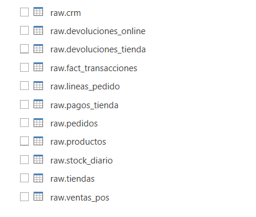

# 03 · SQL Raw → Core → Analytics

| Capítulo | Audiencia | Duración | Tecnología |
| --- | --- | --- | --- |
| 2 · Poner orden en los datos | Ingeniería de datos, BI, arquitectura | 30–60 min | Azure SQL Database o Fabric SQL Database · sqlcmd · Fabric CLI · Python (pyodbc) |

## La historia en este punto

Los notebooks han demostrado que los datos se pueden arreglar. Ahora FraSoHome necesita que el arreglo sea **permanente y auditable**: una base donde los datos lleguen tal y como salen de cada sistema, otra donde vivan limpios y relacionados, y una tercera pensada para analizar. Si mañana alguien pregunta de dónde sale una cifra, tiene que poder seguir el rastro hasta el CSV original.

## Qué se demuestra

- **Raw**: aterrizaje fiel y tolerante, todo como texto, con auditoría de carga. Los errores se conservan.
- **Core**: modelo operacional limpio con claves naturales estandarizadas, FK y una tabla de incidencias de calidad.
- **Analytics**: modelo en estrella (`dw.dim_*`, `dw.fact_*`) para KPI, BI y ML.
- Una base raw **consolidada** con todos los dominios (retail, marketing, personas, RAG y tablas puente) y vistas de ayuda.
- Que la creación de una Fabric SQL Database se hace con la CLI o la API, no con `CREATE DATABASE`.

## Recursos necesarios

### Entorno

| Recurso | Para qué |
| --- | --- |
| Azure SQL Database o Fabric SQL Database | Motor de destino |
| [`sqlcmd`](https://learn.microsoft.com/sql/tools/sqlcmd/sqlcmd-utility) con autenticación Microsoft Entra (`-G`) | Ejecutar los DDL y las cargas |
| [Fabric CLI](https://microsoft.github.io/fabric-cli/) (`fab auth login`) | Crear las tres Fabric SQL Databases |
| PowerShell 7 | Script de despliegue |
| Python 3.10+, `pandas`, `pyodbc` y ODBC Driver 17/18 | Carga alternativa desde Python |

### Datos

| Carpeta | Esquema de destino |
| --- | --- |
| [`datos/retail_omnicanal/raw_csv`](../../datos/retail_omnicanal/README.md) | `raw` / `raw_retail` |
| [`datos/marketing_precision/raw_csv`](../../datos/marketing_precision/README.md) | `raw_marketing` |
| [`datos/people_analytics/raw_csv`](../../datos/people_analytics/README.md) | `raw_people` |
| [`datos/rag_copilot_studio`](../../datos/rag_copilot_studio/README.md) (CSV) | `raw_rag` |
| [`datos/relaciones`](../../datos/relaciones/README.md) | `xref` |

El manifiesto [`table_file_manifest.csv`](sql_database_consolidated/table_file_manifest.csv) relaciona cada CSV con su tabla.

### Material de la demo

| Carpeta | Contenido |
| --- | --- |
| [`retail_sql_database`](retail_sql_database/README.md) | [`ddl_raw_retail.sql`](retail_sql_database/ddl_raw_retail.sql) (esquema `raw` de retail) y [`truncate_raw_retail_tables.sql`](retail_sql_database/truncate_raw_retail_tables.sql) |
| [`fabric_databases`](fabric_databases/README.md) | [`01_FraSoHome_Core.sql`](fabric_databases/01_FraSoHome_Core.sql), [`02_FraSoHome_Analytics.sql`](fabric_databases/02_FraSoHome_Analytics.sql) y [`deploy_fabric_databases.ps1`](fabric_databases/deploy_fabric_databases.ps1) |
| [`sql_database_consolidated`](sql_database_consolidated/README.md) | Base raw consolidada: tablas, procedimientos de carga, plantilla `sqlcmd`, vistas y JSON |
| [`carga_python`](carga_python/README.md) | [`carga-csv.py`](carga_python/carga-csv.py) y [`run-sql.py`](carga_python/run-sql.py) para cargar con pandas + pyodbc |
| [`powerbi/Pedidos-Online.pbix`](powerbi/Pedidos-Online.pbix) | Informe de ejemplo sobre la capa analítica: pedidos online, importe, margen y devoluciones por producto, cliente y fecha (`fact_pedidosonline`, `dim_productos`, `dim_clientes`, `dim_Fecha`) |

## Cómo ejecutarla

### Opción A · Tres Fabric SQL Databases

```powershell
fab auth login
.\escenarios\03-sql-raw-core-analytics\fabric_databases\deploy_fabric_databases.ps1 `
  -WorkspaceName "FraSoHome Demo" `
  -RawSqlEndpoint "xxxxx.database.fabric.microsoft.com" `
  -CoreSqlEndpoint "yyyyy.database.fabric.microsoft.com" `
  -AnalyticsSqlEndpoint "zzzzz.database.fabric.microsoft.com"
```

El script crea `FraSoHome_Raw`, `FraSoHome_Core` y `FraSoHome_Analytics` (si no existen) y aplica sus DDL. Los endpoints SQL se copian del portal de Fabric después de crear cada base.

### Opción B · Una base raw consolidada

```powershell
sqlcmd -S <servidor> -d <base> -G -i .\escenarios\03-sql-raw-core-analytics\sql_database_consolidated\01_create_raw_database.sql
sqlcmd -S <servidor> -d <base> -G -i .\escenarios\03-sql-raw-core-analytics\sql_database_consolidated\02_create_load_procedures.sql
sqlcmd -S <servidor> -d <base> -G -v DataRoot="C:\repos\frasohome-demos\datos" -i .\escenarios\03-sql-raw-core-analytics\sql_database_consolidated\03_load_all_csv_template.sql
sqlcmd -S <servidor> -d <base> -G -i .\escenarios\03-sql-raw-core-analytics\sql_database_consolidated\04_create_semantic_views.sql
```

`BULK INSERT` necesita que el motor vea la ruta de `DataRoot`. En Azure SQL o Fabric no ve tu disco: usa la opción C.

### Opción C · Carga desde Python

```powershell
cd escenarios\03-sql-raw-core-analytics\carga_python
pip install pandas pyodbc
# Define las variables de .env.example en tu sesión (no guardes credenciales en el repositorio)
$env:AZURE_SQL_SERVER = "<servidor>.database.windows.net"
$env:AZURE_SQL_DATABASE = "frasohome"
$env:AZURE_SQL_USERNAME = "<usuario>"
$env:AZURE_SQL_PASSWORD = "<contraseña>"
$env:CSV_FOLDER = "..\..\..\datos\retail_omnicanal\raw_csv"
$env:schema = "raw"
python run-sql.py --file ..\retail_sql_database\ddl_raw_retail.sql
python carga-csv.py
```

Resultado: las once tablas `raw.*` de retail.



### El informe Power BI

`Pedidos-Online.pbix` es un informe ligero conectado a un modelo semántico publicado en Power BI Service. Al abrirlo en otro tenant no tendrá datos: úsalo como referencia de páginas y visuales, o vuelve a apuntarlo (**Transformar datos → Configuración del origen de datos**) a tu propio modelo construido sobre la capa Analytics.

## Guion sugerido (30 min)

| Minuto | Bloque | Qué enseñar |
| --- | --- | --- |
| 0–5 | Por qué tres capas | Auditar, operar y analizar son necesidades distintas |
| 5–12 | Raw | Todo `NVARCHAR`, auditoría de carga y un `SELECT` con los errores intactos |
| 12–20 | Core | Claves estándar, FK y `quality.data_quality_issue` |
| 20–27 | Analytics | La estrella: `fact_sales_transaction`, `fact_return`, `fact_stock_snapshot`, `fact_payment` |
| 27–30 | Consolidado | Las vistas `xref` que conectan retail, marketing y personas |

## Mensajes clave

- Raw no se limpia: es la evidencia.
- Core es donde se aplican las reglas que se descubrieron en el [escenario 02](../02-fabric-preparacion-datos/README.md).
- Analytics se diseña para preguntas, no para sistemas.

## Notas

- Los DDL de Core y Analytics crean la estructura. Su carga desde Raw se hace con las reglas de los notebooks del escenario 02 o como ejercicio de T-SQL.
- El [perfil de datos](../02-fabric-preparacion-datos/perfil-datos.md) documenta las decisiones de modelado de cada capa.

## Con datos vivos (opcional)

Esta demo usa todos los CSV de `datos/`: una fotografía de 2024–2025 con errores intencionados. Si quieres trabajar con datos que cambien, el [escenario 11](../11-web-transaccional/README.md) es una web real donde se venden, devuelven y atienden pedidos sobre Azure SQL y Cosmos DB, y su exportación (`tools/export_csv.py`) los devolverá al mismo formato que `datos/`, sin tocar el código de esta demo.

La exportación todavía no está construida (fase 5 del escenario 11). Hasta entonces, usa `datos/` como hasta ahora.
