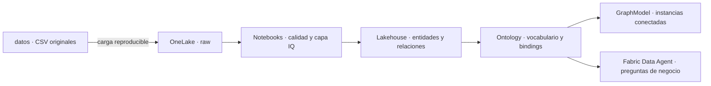

# FraSoHome — contexto empresarial con Fabric IQ

Demo desplegable de ontología, grafo y agente de datos sobre las fuentes reales de `datos`. Adapta la progresión didáctica del laboratorio **Retail Supply Chain** de Microsoft Ontology Playground al caso omnicanal de FraSoHome.

El resultado no es solo un modelo conceptual: el repositorio carga los CSV en OneLake, crea tablas Delta gobernadas, publica una ontología acumulativa de seis etapas, actualiza su grafo asociado y configura un Fabric Data Agent conectado a ese contexto.

## Qué despliega

| Objeto Fabric | Nombre predeterminado | Función |
| --- | --- | --- |
| Workspace | `FraSoHome Fabric IQ Demo` | Contenedor; se crea solo si se indica una capacidad y no existe |
| Lakehouse con esquemas | `FraSoHome_IQ` | Zona raw y 42 tablas Delta: 15 entidades, 25 relaciones y 2 tablas de control |
| Notebook | `FraSoHome_IQ_01_Prepare` | Limpia, normaliza y construye las tablas enlazables |
| Notebook | `FraSoHome_IQ_02_Validate` | Comprueba claves, duplicados y relaciones antes de la demo |
| Ontology | `FraSoHome_Context` | Vocabulario empresarial y bindings a OneLake |
| GraphModel hijo | Creado por Ontology | Materialización navegable de instancias y relaciones |
| Data Agent | `FraSoHome_Context_Agent` | Preguntas en lenguaje natural sobre la ontología completa |



## Las seis etapas

| Etapa | Ampliación | Resultado acumulado |
| --- | --- | --- |
| 1 | `Customer`, `Order`, `Product` | Quién compra qué |
| 2 | `OrderLine`, `Category` | Detalle del pedido y taxonomía |
| 3 | `Store`, `Region` | Geografía y tienda preferida |
| 4 | `StoreSale`, `Payment`, `Return` | Operación omnicanal y posventa |
| 5 | `InventoryPosition`, `DemandSignal` | Intención digital frente a disponibilidad |
| 6 | `Campaign`, `Promotion`, `CampaignContact` | Activación y conversión de marketing |

`DemandSignal` es deliberadamente un concepto de negocio, aunque la fuente física sea `eventos_web_app.csv`. Ese salto entre tabla y significado es el argumento central de la demo.

## Requisitos previos

- PowerShell 7 y Azure CLI.
- Sesión iniciada con `az login` en el tenant correcto.
- Capacidad Fabric compatible o un workspace ya asignado a capacidad.
- Rol Contributor o superior en el workspace.
- Estas opciones de tenant habilitadas por un administrador:
  - **Enable Ontology item (preview)**.
  - **User can create Graph (preview)**.
  - **Users can create and share Data agent item types (preview)** para la etapa 6.
- OneLake security deshabilitado en el lakehouse de la demo. Los bindings estáticos de Ontology no lo admiten actualmente.

Ontology, Graph y la gestión programática del Data Agent siguen en preview en julio de 2026. El repositorio usa sus APIs públicas actuales y conserva un paso alternativo manual si la API beta no devuelve el grafo hijo.

## Despliegue completo

1. Crea una configuración local:

   ```powershell
   Copy-Item .\config.example.json .\config.local.json
   ```

2. Edita `config.local.json`:

   - Si ya existe el workspace, completa `workspace.id`.
   - Si debe crearse, deja `workspace.id` vacío y completa `workspace.capacityId`.

3. Valida el repositorio sin acceder a Fabric:

   ```powershell
   pwsh .\deploy.ps1 -ConfigPath .\config.local.json -ValidateOnly
   ```

4. Despliega la ontología completa y el agente:

   ```powershell
   pwsh .\deploy.ps1 -ConfigPath .\config.local.json -Stage 6
   ```

El proceso es idempotente: reutiliza los objetos con el mismo nombre y actualiza sus definiciones. Guarda los identificadores en `.local/fabric_iq_ontology/deployment-state.json`, fuera del control de versiones.

## Ejecución progresiva durante un laboratorio

La primera vez, carga y prepara los datos:

```powershell
pwsh .\deploy.ps1 -ConfigPath .\config.local.json -Stage 1
```

Para avanzar de etapa sin volver a subir ni transformar los CSV:

```powershell
pwsh .\deploy.ps1 -ConfigPath .\config.local.json -Stage 2 -SkipDataUpload -SkipNotebookRun
pwsh .\deploy.ps1 -ConfigPath .\config.local.json -Stage 3 -SkipDataUpload -SkipNotebookRun
pwsh .\deploy.ps1 -ConfigPath .\config.local.json -Stage 4 -SkipDataUpload -SkipNotebookRun
pwsh .\deploy.ps1 -ConfigPath .\config.local.json -Stage 5 -SkipDataUpload -SkipNotebookRun
pwsh .\deploy.ps1 -ConfigPath .\config.local.json -Stage 6 -SkipDataUpload -SkipNotebookRun
```

El agente se crea únicamente en la etapa 6. Cada actualización intenta refrescar el `GraphModel` hijo mediante la API oficial. Si el tenant no expone todavía esa relación beta, el script muestra el único paso manual: en el menú del grafo, **Schedule > Refresh now**.

## Ruta recomendada

- [Arquitectura y decisiones](docs/arquitectura.md)
- [Mapa entre fuentes y conceptos](docs/datos-y-modelo.md)
- [Laboratorio 0 — preparación](docs/00-preparacion.md)
- [Laboratorios 1 a 6](docs/01-comercio-esencial.md)
- [Guion de demo en 15 minutos](docs/guion-demo-15-min.md)
- [Preguntas para el agente](docs/preguntas-demo.md)
- [Solución de problemas](docs/troubleshooting.md)

## Seguridad y calidad por diseño

- Los CSV raw no se modifican.
- Los identificadores se normalizan y las claves duplicadas se resuelven de forma determinista.
- Las relaciones del grafo solo contienen pares con entidades existentes; los huérfanos siguen disponibles en raw para ejercicios de calidad.
- Email y teléfono no se publican como propiedades de `Customer`.
- La ausencia de una relación se interpreta como ausencia de evidencia, no como negación del hecho.

## Limpieza

La eliminación está protegida por confirmación explícita. Por defecto solo borra objetos creados por este repositorio; cualquier objeto preexistente que el despliegue haya reutilizado se conserva:

```powershell
pwsh .\cleanup.ps1
```

Para eliminar también el workspace creado para la demo:

```powershell
pwsh .\cleanup.ps1 -DeleteWorkspace
```

`-DeleteReusedItems` amplía deliberadamente el alcance a objetos preexistentes con los mismos nombres. No lo uses en un workspace compartido; para borrar además un workspace reutilizado habría que combinarlo expresamente con `-DeleteWorkspace`.

## Referencias

- [Microsoft Ontology Playground — Retail Supply Chain](https://github.com/microsoft/Ontology-Playground/tree/main/content/learn/iq-lab-retail-supply-chain), revisión base `683adcc8d5a449b9ca9c82e92aaf51c066025c25`.
- [Fabric IQ y Ontology](https://learn.microsoft.com/en-us/fabric/iq/)
- [Definición pública de un objeto Ontology](https://learn.microsoft.com/en-us/rest/api/fabric/articles/item-management/definitions/ontology-definition)
- [Configuración requerida del tenant](https://learn.microsoft.com/en-us/fabric/iq/ontology/overview-tenant-settings)
- [Definición pública de un Fabric Data Agent](https://learn.microsoft.com/en-us/rest/api/fabric/articles/item-management/definitions/data-agent-definition)
- [Acceso a OneLake mediante APIs ADLS](https://learn.microsoft.com/en-us/fabric/onelake/onelake-access-api)

La estructura pedagógica está inspirada en el laboratorio oficial; el modelo FraSoHome, sus transformaciones, bindings, documentación e instrucciones del agente son específicos de este repositorio.
