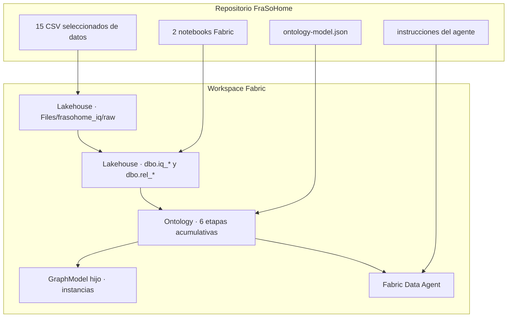

# Arquitectura y decisiones

## Resultado buscado

La demo debe demostrar tres ideas distintas sin mezclarlas:

1. **Los datos** aportan registros y medidas.
2. **La ontología** declara qué significan los conceptos y cómo se relacionan.
3. **El grafo y el agente** consumen ese contexto para navegar y responder.

## Objetos mínimos

Se despliegan un lakehouse, dos notebooks, una ontología y un agente. No se añade un pipeline ni un modelo semántico porque no son necesarios para ejecutar estos laboratorios:

- El despliegue externo ya orquesta la preparación y validación de notebooks.
- La ontología enlaza directamente con tablas Delta administradas en OneLake.
- El Data Agent consume la ontología, no las tablas físicas.
- El grafo hijo se crea como parte del objeto Ontology.

Esa decisión mantiene visible la tesis de la demo: el valor diferencial está en la capa de contexto, no en multiplicar artefactos técnicos.

## Dos tipos de tabla

- `iq_*`: una tabla por entidad de negocio. Puede conservar columnas técnicas para construir relaciones, pero solo las propiedades declaradas quedan expuestas en la ontología.
- `rel_*`: pares `source_id` y `target_id` validados contra sus entidades. Esta separación evita que una clave huérfana bloquee la carga del grafo.

Las tablas `iq_deployment_manifest` e `iq_source_profile` sirven para comprobar el estado de la demo y no forman parte de la ontología.

## Progresión sin seis copias

El laboratorio original publica seis modelos acumulativos. Aquí se mantiene una única ontología y se actualiza su definición con `-Stage 1` a `-Stage 6`. Ventajas:

- el público ve crecer el mismo vocabulario;
- los identificadores de entidades y propiedades son estables;
- no se llena el workspace de versiones paralelas;
- la etapa 6 queda lista para el agente.

Los IDs de la definición pública se derivan de nombres estables mediante SHA-256. Añadir una entidad no cambia los IDs existentes.

## Decisiones semánticas relevantes

### `Order` y `StoreSale` son conceptos distintos

`Order` procede de ecommerce o marketplace. `StoreSale` agrupa líneas POS por ticket. Ambos son ventas en lenguaje cotidiano, pero sus procesos, estados y relaciones no son idénticos. La ontología evita agregarlos accidentalmente.

### `DemandSignal` no es una tabla web

`eventos_web_app.csv` contiene telemetría. La entidad `DemandSignal` expresa intención observable y permite conectar cliente, producto, pedido e inventario. La instrucción del agente impide tratarla como una previsión.

### La identidad es gobernada

Los IDs se recortan y pasan a mayúsculas; valores como `??`, `N/A` o vacío se consideran ausentes. La relación solo se crea si ambos extremos existen. Los registros defectuosos no se borran del raw.

### Privacidad por contrato

La tabla curada de cliente no incluye email ni teléfono. Un agente puede razonar sobre valor, preferencia y comportamiento sin tener acceso a identificadores directos innecesarios.

## Automatización y límites de preview

El repositorio usa APIs oficiales para crear o actualizar todos los objetos. El descubrimiento del grafo hijo utiliza la API beta de relaciones entre items. Si esa relación no aparece en un tenant concreto, el despliegue continúa y solicita un refresco manual desde el menú del grafo. No se recurre a endpoints privados.

Los bindings de Ontology requieren tablas Lakehouse administradas, sin column mapping y con OneLake security deshabilitado. El notebook crea las Delta tables con esas condiciones predeterminadas.
