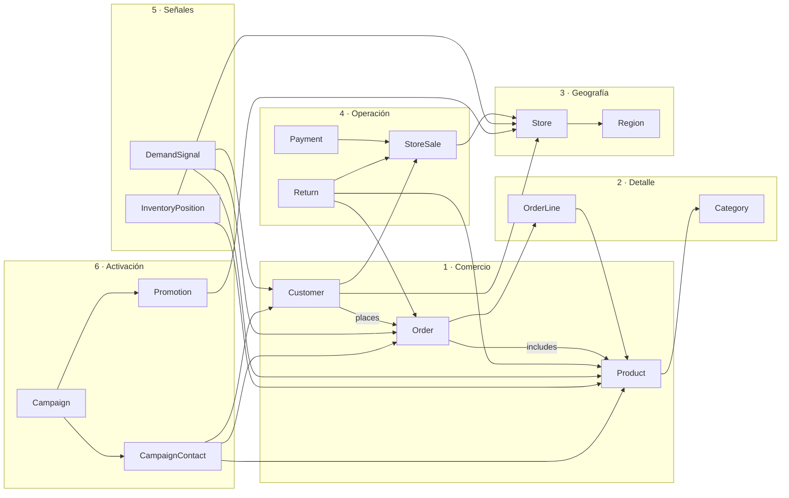

# Datos y modelo semántico

## Fuentes utilizadas

La demo lee 15 CSV originales; no copia ni modifica el contenido de `datos`.

| Dominio | Fuente | Papel en la ontología |
| --- | --- | --- |
| Retail | `crm.csv` | `Customer` |
| Retail | `productos.csv` | `Product`, `Category` |
| Retail | `tiendas.csv` | `Store`, `Region` |
| Retail | `pedidos.csv` | `Order` |
| Retail | `lineas_pedido.csv` | `OrderLine` y relaciones pedido-producto |
| Retail | `ventas_pos.csv` | `StoreSale` y productos de la venta |
| Retail | `pagos_tienda.csv` | `Payment` |
| Retail | `devoluciones_online.csv` | `Return` enlazada a `Order` |
| Retail | `devoluciones_tienda.csv` | `Return` enlazada a `StoreSale` u `Order` |
| Retail | `stock_diario.csv` | `InventoryPosition` |
| Marketing | `eventos_web_app.csv` | `DemandSignal` |
| Marketing | `afinidad_tienda_cliente.csv` | `CustomerPrefersStore` |
| Marketing | `campanas_marketing.csv` | `Campaign` |
| Marketing | `contactos_campana.csv` | `CampaignContact` |
| Marketing | `promociones_calendario.csv` | `Promotion` |

## Hallazgos de calidad que se usan en la narrativa

El perfil local original contiene duplicados de clave y variaciones semánticas intencionales:

- 103 filas CRM para 100 clientes canónicos.
- 101 filas de producto para 100 productos canónicos.
- 656 filas de pedido; tras normalizar clave y resolver duplicados quedan aproximadamente 650.
- 1.949 líneas de pedido con 20 claves duplicadas observadas.
- 2.521 líneas POS con 40 claves duplicadas observadas y 1.200 tickets distintos.
- `Plata`, `plata` y otras variantes se normalizan a un único nivel de fidelización.
- `Centro` y `Central` se tratan como la misma región de negocio.
- Fechas ISO, fechas `DD/MM/AA` y fechas con meses en español se llevan a un mismo tipo temporal.
- Importes con coma o punto decimal, separadores de miles, `EUR`, `€` y cantidades con `uds` se normalizan mediante una regla explícita; formatos realmente ambiguos permanecen nulos en la capa curada y siguen intactos en raw.
- Existen claves huérfanas de cliente, producto, tienda, pedido y ticket; se conservan en raw, pero no se materializan como aristas inválidas.

Las cifras exactas del despliegue quedan registradas en `dbo.iq_source_profile` y `dbo.iq_deployment_manifest`.

En la validación local de esta versión, las columnas utilizadas contienen 16.946 fechas no vacías y todas encajan en los formatos tratados. De 32.648 valores numéricos no vacíos, 32.642 se normalizan; los seis restantes son el texto ambiguo `100,0,0` de devoluciones en tienda y se conservan como nulos en la tabla curada, sin alterar el raw. Estas cifras son previas a la deduplicación.

## Entidades por etapa

## Propiedades y relaciones

El contrato completo es [ontology-model.json](../fabric/ontology/ontology-model.json). Ese archivo es la fuente de verdad para:

- nombres de entidad y propiedad;
- etapa de introducción;
- tabla y columna de cada binding;
- clave y etiqueta de visualización;
- dirección y evidencia física de cada relación;
- descripción que recibe el Data Agent.

La ontología completa contiene 15 entidades, 25 relaciones y 114 propiedades. Los nombres de propiedad están prefijados por entidad para evitar ambigüedad y facilitar la selección por agentes.

## Ejemplo de elevación semántica

| Capa física | Capa semántica | Interpretación |
| --- | --- | --- |
| `eventos_web_app.tipo_evento = add_to_cart` | `DemandSignal.DemandSignalType` | intención fuerte, no venta |
| `stock_diario.stock_cierre - stock_minimo` | `InventoryPosition.InventoryGap` | riesgo si es menor o igual a cero |
| `contactos_campana.order_id_conversion_30d` | `ContactConvertsToOrder` | atribución explícita a pedido |
| `afinidad_tienda_cliente.store_id_preferida` | `CustomerPrefersStore` | preferencia, no lugar de toda compra |

Este contraste es el punto de conversación más importante para la presentación: el contexto formaliza lo que una columna significa y, también, lo que no significa.
