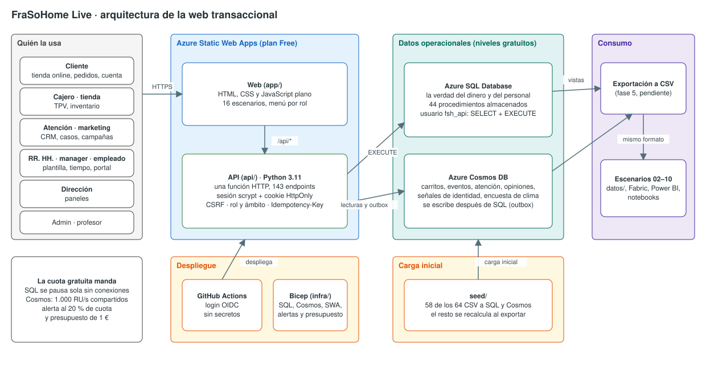

# 11 · Web transaccional (FraSoHome Live)

| Capítulo | Audiencia | Duración | Tecnología |
| --- | --- | --- | --- |
| Transversal · datos vivos para el resto de escenarios | Arquitectura, ingeniería de datos, desarrollo de aplicaciones, formación | 20–30 min demo · 2 h recorrido completo | Azure Static Web Apps, Azure SQL Database, Azure Cosmos DB, Python 3.11, Bicep, GitHub Actions |

## La historia en este punto

Los diez escenarios anteriores trabajan con una fotografía: los CSV de [`datos/`](../../datos/README.md), que acaban en 2025 y tienen errores puestos a propósito. Pero esos datos salieron de algún sitio. Alguien vendió en una tienda, alguien devolvió un sofá, alguien abrió un caso en atención al cliente, alguien aprobó unas horas extra.

Este escenario enseña **el otro lado**: la aplicación que produce los datos. FraSoHome Live es una web real, con usuarios, roles y transacciones, desplegada en Azure con servicios gratuitos. La verdad vive en Azure SQL y Azure Cosmos DB, y todo lo que se opera en la web se puede llevar al mismo formato de los CSV para que el resto de escenarios funcione con datos nuevos.

## Qué se demuestra

- **Una aplicación completa a coste cero.** Static Web Apps, Azure SQL Database y Cosmos DB en sus niveles gratuitos, con alertas de cuota y presupuesto de 1 €.
- **Dos bases, dos papeles.** SQL guarda lo que debe cuadrar (dinero, stock, personas) y lo modifica solo con procedimientos almacenados. Cosmos guarda lo que cambia de forma o de ritmo: carritos, eventos de navegación, conversaciones de atención, opiniones y señales de identidad.
- **Primero SQL, después Cosmos.** No hay transacción entre las dos bases: si Cosmos falla, el evento espera en una cola (*outbox*) y se reintenta.
- **Operaciones que no se duplican.** Cobrar, emitir un ticket o devolver llevan `Idempotency-Key`: repetir la petición no cobra dos veces ni mueve el stock dos veces.
- **Autenticación propia con rol y ámbito.** Once roles. Un cliente solo ve sus pedidos, un cajero solo su tienda y un manager solo su equipo, y sin salarios.
- **Gobierno de marca en el flujo.** Las creatividades de una campaña pasan por las reglas de marca antes de guardarse.
- **Infraestructura como código y despliegue sin secretos.** Bicep, GitHub Actions con identidad federada (OIDC), sin contraseñas en el repositorio.
- **16 escenarios de negocio sobre los 64 ficheros de datos.** Cada CSV aparece al menos una vez, como dato que se opera o como resultado que se consulta.

## Arquitectura

| Decisión | Por qué |
| --- | --- |
| HTML, CSS y JavaScript plano, sin framework | La política de seguridad de contenido solo admite scripts propios, el código se lee de principio a fin y no hay nada que compilar |
| Una sola función HTTP con enrutador propio | Toda la API se prueba con pytest sin el host de Functions, y la oferta gratuita de Static Web Apps solo admite *managed functions* |
| Usuario de base de datos `fsh_api` con `SELECT` y `EXECUTE` | Las escrituras van siempre por procedimientos almacenados; la aplicación no puede hacer `UPDATE` directo |
| Contraseñas con `scrypt` y sesión en SQL | Sin proveedores externos: `/.auth/*` de Static Web Apps está bloqueado, así que no existe otra puerta de entrada |
| Datos sintéticos con nombres, correos y salarios | El módulo de RR. HH. y el CRM solo se ven con su rol |

## Cómo se construyó

| Fase | Contenido | Estado |
| --- | --- | --- |
| [0 · Comprobaciones](fase0/README.md) | Función de prueba, infraestructura mínima y scripts de verificación | Validada en Azure (falta el dominio) |
| [1 · Infraestructura como código](infra/README.md) | Bicep completo, alertas de cuota y presupuesto, GitHub Actions | Desplegada en Azure |
| [2 · Modelo y carga inicial](seed/README.md) | DDL, carga de los CSV en SQL y Cosmos, verificación | Cargada en Azure |
| [3 · API y autenticación](api/README.md) | Usuarios y contraseñas propios, transacciones, 143 endpoints | Desplegada en Azure |
| [4 · Web](web.md) | Los 16 escenarios | Publicada en Azure |
| 5 · Exportación a CSV | Mismo formato que `datos/` | Pendiente |
| 6 · Tráfico, dominio y operación | Generador de tráfico, guía | Pendiente |
| 7 · Documentación | Esta ficha, el diagrama y la matriz de recursos | Hecha |

## Recursos necesarios

### Entorno

| Recurso | Para qué |
| --- | --- |
| Suscripción de Azure con permisos de propietario | Crear el grupo de recursos, las bases y la identidad de GitHub Actions |
| Azure CLI 2.53 o superior (`az login`) | Desplegar la infraestructura y publicar la web |
| Python 3.10 o superior | Cargar los datos y crear usuarios (los scripts preparan su propio entorno) |
| Node.js (`npx`) | CLI de Static Web Apps para publicar |
| PowerShell | Scripts de despliegue (`.ps1`) |
| GitHub CLI (`gh`) | Configurar el entorno de GitHub Actions (opcional) |
| Un navegador actual | Usar la web |

No hace falta Docker ni SQL Server en local: las pruebas de la API que lo usan están descritas en [`api/README.md`](api/README.md#pruebas-en-local).

### Datos

Los 64 CSV de [`datos/`](../../datos/README.md). De ellos, 58 se guardan en las bases (27 tablas SQL operadas, 23 SQL de semilla, referencia y metadatos, y 8 contenedores Cosmos) y 6 los recalcula la exportación.

### Material

| Carpeta | Contenido |
| --- | --- |
| [`web.md`](web.md) | Cómo está hecha la web, por escenarios y por roles |
| [`datos-en-vivo.md`](datos-en-vivo.md) | Modelo de datos de SQL y Cosmos DB, diagramas y cómo conectar desde otras demos |
| [`referencia-sql.md`](referencia-sql.md) | Las 59 tablas con sus columnas, tipos y claves |
| [`app/`](app/index.html) | La web: HTML, CSS y JavaScript |
| [`api/`](api/README.md) | La API: 143 endpoints, autenticación y transacciones |
| [`sql/`](sql/01_core.sql) | Modelo de datos y 44 procedimientos almacenados |
| [`seed/`](seed/README.md) | Carga inicial, verificación y reinicio de los datos |
| [`infra/`](infra/README.md) | Bicep, alertas, presupuesto y GitHub Actions |
| [`tools/`](tools/usuarios.ps1) | Usuarios, configuración y publicación |
| [`fase0/`](fase0/README.md) | Las comprobaciones previas en Azure |
| [Plan de la web transaccional](FraSoHome%20Live%20—%20plan%20de%20la%20web%20transaccional%20con%20Azure%20gratuito%20y%20Fabric.md) | Decisiones, mapa de datos, riesgos y costes |

## Cómo ejecutarla

### Opción A · Usar la web ya desplegada

1. Abre la web (`https://<tu-static-web-app>.azurestaticapps.net`; en esta instalación el nombre está en `.local\frasohome-live\estado.json`, campo `swaHostname`).
2. Entra con un usuario de demostración. Hay uno por rol y doce clientes del CRM. Las contraseñas temporales se guardan en `.local\frasohome-live\usuarios_demo.txt` y cada usuario debe cambiarla en el primer acceso:

| Usuario | Rol | Ámbito |
| --- | --- | --- |
| `cliente.c0017` (y once más, `cliente.cNNNN`) | cliente | Su ficha de cliente |
| `cajero.madrid` | cajero y empleado | Tienda S001 |
| `tienda.madrid` | tienda | Tienda S001 |
| `almacen.online` | tienda | Almacén ONLINE: prepara pedidos |
| `atencion.demo`, `marketing.demo` | atención, marketing | Sin ámbito |
| `rrhh.demo` | rrhh | Toda la plantilla |
| `manager.demo` | empleado y manager | Su equipo |
| `empleado.demo` | empleado | Su ficha de empleado |
| `direccion.demo` | direccion | Paneles de solo lectura |
| `profesor.demo` | profesor | Laboratorio docente |
| `admin.demo` | admin | Todo lo administrable |

3. Para listar, crear o reiniciar usuarios: `tools\usuarios.ps1 list`, `add`, `reset` o `disable`.

### Opción B · Desplegarla desde cero

Requisitos: las herramientas de la tabla de entorno y `az login` hecho.

1. **Revisar la suscripción y crear lo mínimo** ([fase 0](fase0/README.md)): `fase0\comprobar_suscripcion.ps1` y `fase0\desplegar.ps1 -Region westeurope`.
2. **Infraestructura completa** ([fase 1](infra/README.md)): `infra\desplegar_infra.ps1 -AlertEmail tu@correo.com`, con el *what-if* delante. Si aparece un `Delete`, cancela. Después `infra\configurar_github.ps1` para los flujos de GitHub Actions.
3. **Cargar los datos** ([fase 2](seed/README.md)): `seed\cargar_datos.ps1`. Tarda unos minutos y gasta cuota de Cosmos y de SQL, así que no se repite sin necesidad.
4. **Preparar y publicar la API y la web** ([fase 3](api/README.md#desplegar-en-azure)): `tools\configurar_api.ps1 -GuardarDemo` y `tools\desplegar_api.ps1`. El segundo termina con ocho comprobaciones contra la URL publicada.

A partir de ahí, cada cambio en `app/` o `api/` que llegue a `main` se publica solo con el flujo `frasohome-live-web`.

### Antes de una demo

- **Reiniciar los datos** si quieres partir de cero: `seed\cargar_datos.ps1 -Reiniciar`. Los usuarios se conservan. Gasta cuota, así que no lo hagas antes de cada pase.
- **Despertar la base.** La base SQL gratuita se pausa sola y la primera petición puede tardar un minuto. Abre la web un par de minutos antes.
- **Cerrar herramientas** (SSMS, VS Code con extensiones SQL) al terminar: una conexión abierta impide la pausa y gasta los 100.000 segundos de vCore del mes.

## Los 16 escenarios

| # | Escenario | Entra como | Qué se ve |
| --- | --- | --- | --- |
| 1 | Compra online | cliente | Catálogo, carrito con cupón, checkout, seguimiento |
| 2 | Venta en tienda (TPV) | cajero | Caja, ticket con cobro mixto, cierre |
| 3 | Devoluciones | cliente, cajero, atención | Solicitud, devolución en tienda, reembolso |
| 4 | Inventario y reposición | tienda | Stock vivo, tránsito, alertas, cierre diario |
| 5 | Catálogo y tiendas | admin | Altas, precios, fichas |
| 6 | Clientes y fidelización | atención, marketing, cliente | CRM, puntos, identidad |
| 7 | Gestión de campañas | marketing | Del brief al resultado |
| 8 | Promociones | marketing | Calendario y reglas |
| 9 | Atención al cliente | atención, cliente | Bandeja con SLA, compensación |
| 10 | Voz del cliente | cliente, atención | Reseñas, NPS, moderación |
| 11 | Ciclo de vida del empleado | rrhh | Alta, movimiento, salario, baja |
| 12 | Tiempo y desempeño | rrhh, manager | Ausencias, horas extra, evaluación |
| 13 | Portal del empleado | empleado | Mis datos y encuesta de clima |
| 14 | Paneles de dirección | direccion | Ventas, 360, rotación |
| 15 | Administración de datos | admin | Usuarios, calidad, outbox |
| 16 | Laboratorio docente | profesor | Identidad, RAG, prompts |

## Guion sugerido (20–30 min)

Una pasada corta que cruza las dos bases y los roles. Necesita tres ventanas del navegador, una por usuario.

1. **Presentar el problema (2 min).** Los CSV son una foto. Aquí hay una aplicación que genera los datos. Muestra el [diagrama](#arquitectura).
2. **Comprar (4 min).** Como `cliente.c0017`: busca un producto, añádelo al carrito, aplica un cupón y confirma. Fíjate en el stock disponible y en el envío calculado en el servidor.
3. **Preparar y entregar (2 min).** Como `almacen.online`: abre el pedido, pásalo a «En preparación» y a «Entregado».
4. **Devolver (3 min).** Como el cliente: solicita la devolución de una línea. Como `atencion.demo`: acéptala y márcala como reembolsada. El stock vuelve solo.
5. **Vender en tienda (3 min).** Como `cajero.madrid`: abre caja, vende con cobro mixto (tarjeta y efectivo) y cierra. Cuenta que, si se corta la red y se repite el cobro, el servidor devuelve el mismo ticket en lugar de cobrar dos veces.
6. **Campaña (4 min).** Como `marketing.demo`: crea una campaña, construye la audiencia con grupo de control, intenta una creatividad con «descuento» sin condiciones (la regla de marca la rechaza), corrígela, lanza y atribuye.
7. **Dirección (3 min).** Como `direccion.demo`: ventas de 2025 en el panel, y la ficha 360 del cliente que acabas de usar.
8. **Cerrar (2 min).** Como `admin.demo`: usuarios, auditoría y outbox. Recuerda qué lleva a cada base y cómo saldría hacia los CSV.

## Guiones por escenario

Cada guion dura entre 3 y 8 minutos y se puede usar suelto. Todos se prueban con los usuarios de demostración.

### 1 · Compra online

Entra como un cliente (`cliente.c0017`).
1. En **Tienda online** filtra por categoría y abre una ficha: disponibilidad por tienda, promociones vigentes y opiniones publicadas.
2. Añade dos productos al **carrito**. Prueba un cupón de **Mis cupones** (Pedidos → Mis cupones): el presupuesto cambia al instante.
3. **Finalizar compra** con dirección y método de pago. El pedido nace «Pendiente»; puedes cancelarlo mientras lo esté.

*Mensaje:* el carrito vive en Cosmos, el pedido y el stock en SQL, todo en una transacción. Los eventos de navegación van también a Cosmos.

### 2 · Venta en tienda (TPV)

Entra como `cajero.madrid`.
1. **Venta en tienda → Caja**: abre la caja `CAJ01` con el efectivo inicial.
2. **Nuevo ticket**: busca al cliente por tarjeta de fidelización (si la tiene), añade productos y aplica un cupón.
3. Cobra con **dos métodos** (por ejemplo, tarjeta y efectivo). El botón de cobrar se activa solo cuando lo cobrado cuadra con el total.
4. Mira el ticket, imprímelo y **cierra la caja** contando el efectivo.

*Mensaje:* si repites la petición de cobro, la respuesta es la misma y no se mueve el stock otra vez.

### 3 · Devoluciones

1. Como cliente, abre un pedido **Entregado** y pulsa «Devolver» en una línea (motivo y método).
2. Como `atencion.demo`, abre la devolución y acéptala; luego márcala «Reembolsada».
3. Como `cajero.madrid`, **Devolver en tienda**: busca un ticket o un pedido online ya entregado y registra la devolución con el método de reembolso.

*Mensaje:* el reembolso y el reingreso a stock ocurren en el procedimiento almacenado, no en la pantalla.

### 4 · Inventario y reposición

Entra como `tienda.madrid`.
1. **Stock**: filtra «solo bajo mínimo» y ajusta una línea con su motivo.
2. **Reponer** deja la mercancía «en tránsito»; **Recibir** la pasa a existencias.
3. **Alertas** ordena los productos bajo mínimo con las ventas de siete días. **Movimientos** deja el rastro de cada cambio.
4. Como `admin.demo`: **Cierre diario** fotografía el stock de todas las tiendas.

### 5 · Catálogo y tiendas

Entra como `admin.demo`.
1. **Catálogo y tiendas**: crea un producto con precio, coste e IVA y descatalógalo después (desaparece de la tienda).
2. Edita la ficha de una tienda (horario, gerente, estado).
3. Abre **Alias de producto**: la equivalencia entre los códigos del escenario RAG y los del retail.

### 6 · Clientes y fidelización

Entra como `atencion.demo`.
1. **Clientes**: busca por nombre, correo o teléfono y abre una ficha: datos, actividad y afinidad con la tienda.
2. **Ajustar puntos** con motivo y **Cambiar estado**.
3. **Identidad**: abre una señal sin asignar, mira los candidatos que comparten correo, teléfono o tarjeta y asígnala.
4. Como cliente: **Mi cuenta** muestra puntos y deja cambiar contacto y consentimientos.

*Mensaje:* es la misma consola de identidad que se evalúa en el escenario 16.

### 7 · Gestión de campañas

Entra como `marketing.demo`.
1. **Campañas → Nueva campaña**: objetivo, canal, segmento, oferta, presupuesto y grupo de control.
2. **Construir audiencia**: se reparten tratamiento y control.
3. **Creatividades → Nueva**: escribe un mensaje con un descuento sin condiciones. La regla de marca lo rechaza y dice cuál. Añade validez y mínimo y se guarda.
4. **Emitir cupones**, **Lanzar** (simula entregas, aperturas y clics) y **Atribuir conversiones a 30 días**.
5. **Resultados**: conversión de tratamiento y control, uplift, margen neto y cupones canjeados.

### 8 · Promociones

1. **Promociones**: filtra por vigencia (vigentes, futuras, terminadas).
2. Crea una promoción con ámbito, canal, umbral de cesta y margen mínimo, y marca si es combinable.
3. Comprueba en la tienda online que una promoción vigente aparece en la ficha del producto.

### 9 · Atención al cliente

1. Como cliente: **Mis casos → Nueva consulta** sobre un pedido.
2. Como `atencion.demo`: la **Bandeja** pone primero lo vencido y después por prioridad. Abre el caso, responde y **resuelve con un cupón** de compensación.
3. Como cliente: abre el caso y **valóralo (CSAT)**.

*Mensaje:* la conversación es un documento anidado en Cosmos; el cupón de compensación es una fila de SQL.

### 10 · Voz del cliente

1. Como cliente: desde un pedido entregado, pulsa **Opinar** (reseña de un producto comprado) o responde la pregunta de NPS.
2. Como `atencion.demo`: **Moderación** → publica y responde.
3. **Temas y sentimiento**: valoración media, NPS y sentimiento por tema.

### 11 · Ciclo de vida del empleado

Entra como `rrhh.demo`.
1. **Plantilla**: filtra por departamento y abre una ficha (movimientos, evaluaciones, compensación).
2. **Nuevo empleado**, después **Movimiento** (promoción) y **Revisión salarial**.
3. **Dar de baja** con la entrevista de salida: el comentario acaba en Cosmos.
4. Como `manager.demo`, la misma pantalla muestra solo a su equipo y sin salarios.

### 12 · Tiempo y desempeño

1. Como `rrhh.demo`: **Ausencias → Registrar** y **Formación → Inscribir** a un empleado.
2. Como `manager.demo`: **Mi equipo**, evalúa a alguien y mira las **horas extra** pendientes de su equipo.
3. Aprueba o rechaza unas horas extra. Un manager no puede decidir sobre alguien que no es de su equipo.

### 13 · Portal del empleado

Entra como `empleado.demo`.
1. **Mis datos**: puesto, manager, salario propio y días de ausencia.
2. **Horas extra → Solicitar** y **Formación → Inscribirme**.
3. **Encuesta de clima**: ocho preguntas de 1 a 5. Solo se contesta una vez por trimestre.

### 14 · Paneles de dirección

Entra como `direccion.demo` (solo lectura).
1. **Ventas**: pulsa «2025», porque los datos de carga acaban ahí. Columnas apiladas de tienda y online, con detalle al pasar el ratón.
2. **Cliente 360** y **Empleado 360**: toda la información en una pantalla (pedidos, tickets, campañas, opiniones, casos; riesgo de abandono y clima).
3. **Rotación** y **Comentarios** de clima y de salida.

### 15 · Administración de datos

Entra como `admin.demo`.
1. **Usuarios**: crea uno con su rol y ámbito (la contraseña temporal se muestra una vez), reiníciala y desactívalo.
2. **Calidad de la carga**: lo que se corrigió o rechazó al pasar los CSV a SQL.
3. **Catálogo y diccionarios**: los ficheros de metadatos como tablas.
4. **Outbox** y **Auditoría**.

*Pendiente (fase 5):* exportación a CSV desde esta pantalla.

### 16 · Laboratorio docente

Entra como `profesor.demo`.
1. **Identidad**: cuántas señales ha asignado bien el alumnado frente a la verdad conocida, con los errores y las pendientes.
2. **Juegos RAG**: crea, edita y borra casos de prueba.
3. **Muestras de prompt**, **Backlog de indicadores** y **Tablas RAG**.

## Mensajes clave

- **Los datos tienen origen.** Un CSV es una foto; la aplicación es lo que la genera.
- **Cada dato vive donde mejor encaja.** Lo que debe cuadrar, en SQL; lo que cambia de forma, en Cosmos.
- **Las reglas de negocio están en la base**, en procedimientos almacenados, no repartidas por la pantalla.
- **Seguridad por capas.** Rol y ámbito en cada petición, y el menú solo es comodidad.
- **Gratis no es gratis sin cuidado.** Hay cuotas, alertas y una forma de operar (cerrar herramientas, reiniciar poco).

## Notas de ejecución

- **Datos de la carga y datos nuevos.** Los de 2024–2025 vienen de los CSV. Lo que se opere hoy lleva fecha de hoy, y entre ambos hay un hueco de unos diez meses hasta que el generador de tráfico de la fase 6 lo rellene.
- **Cuotas.** SQL gratuita: 100.000 segundos de vCore al mes, unas 55 horas activas. Cosmos: 1.000 RU/s compartidas. Las alertas avisan al 20 % y al superar el 90 %.
- **Datos de prueba.** Quien ensaya en la instalación deja pedidos, tickets y casos. `seed\cargar_datos.ps1 -Reiniciar` los borra, a cambio de gastar cuota.
- **Dominio propio.** La web está en la dirección de Static Web Apps. El dominio `frasohome.dataging.com` está previsto para la fase 6.

## Con el resto de escenarios

Para crear demos nuevas que lean estos datos directamente, mira [Datos en vivo](datos-en-vivo.md): diagramas, usuario de solo lectura y ejemplos de conexión.

La exportación a los mismos CSV de `datos/` es la fase 5 y todavía no está construida. Cuando lo esté, cada escenario leerá su parte con `--dominio`:

| Escenarios | Dominio de la exportación |
| --- | --- |
| 02, 10 | `retail` |
| 03 | Todos |
| 04, 05, 08 | `retail` y `marketing` |
| 06 | `people` (y `relaciones` para la asignación de empleados a tiendas) |
| 07 | `rag` |
| 09 | `rag` y `retail` |

Hasta entonces, el resto de escenarios sigue funcionando con `datos/`, que se conserva sucio a propósito para las demos de calidad de datos.

## Material complementario

- [Cómo está hecha la web](web.md)
- [Datos en vivo: modelo y conexión](datos-en-vivo.md) y [referencia del esquema SQL](referencia-sql.md)
- [La API](api/README.md)
- [Infraestructura como código](infra/README.md)
- [Carga inicial de datos](seed/README.md)
- [Plan de la web transaccional](FraSoHome%20Live%20—%20plan%20de%20la%20web%20transaccional%20con%20Azure%20gratuito%20y%20Fabric.md)
- [Diagrama de arquitectura](../../diagramas/README.md)
