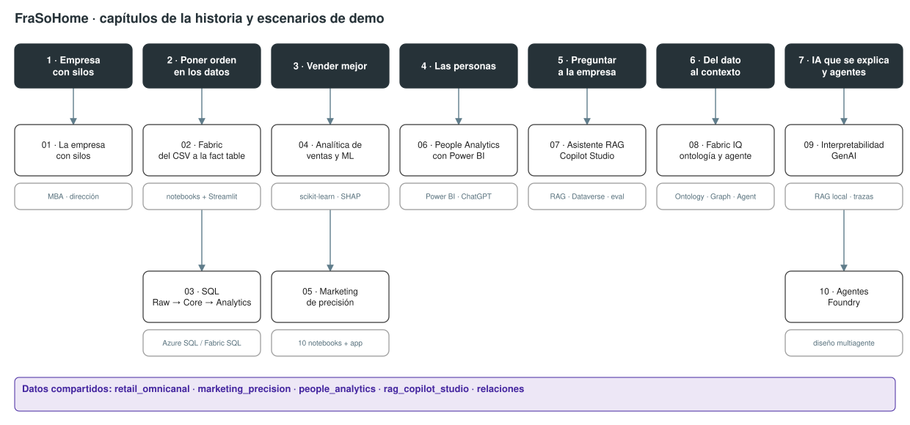

# Escenarios de demo

Diez demos que recorren la [historia de FraSoHome](../historia/README.md). Todas usan el mismo universo de [datos](../datos/README.md), así que se pueden encadenar en un taller o presentar por separado.

## Catálogo

| # | Escenario | Audiencia | Tecnología | Duración | Ejecución |
| --- | --- | --- | --- | --- | --- |
| 01 | [La empresa con silos](01-empresa-con-silos/README.md) | MBA, dirección, clase introductoria | Presentación + datos | 20–45 min | Sin instalación |
| 02 | [Fabric: del CSV a la fact table](02-fabric-preparacion-datos/README.md) | Equipos de datos, preventa, formación Fabric | Microsoft Fabric o Python local, Streamlit | 40 min demo · 8–10 h curso | Notebooks |
| 03 | [SQL Raw → Core → Analytics](03-sql-raw-core-analytics/README.md) | Ingeniería de datos, BI | Azure SQL, Fabric SQL Database, sqlcmd | 30–60 min | Scripts SQL y PowerShell |
| 04 | [Analítica de ventas y ML](04-analitica-ventas-ml/README.md) | Analistas, data science, máster | Python, scikit-learn, SHAP, LIME | 2 sesiones de 8 h | Notebooks locales |
| 05 | [Marketing de precisión](05-marketing-precision/README.md) | Marketing, CRM, ecommerce, data science | Python, scikit-learn, Streamlit | 30 min demo · 1–2 días curso | Notebooks + app |
| 06 | [People Analytics con Power BI](06-power-bi-people-analytics/README.md) | RR. HH., dirección, analítica aplicada | Power BI, Power Query, ChatGPT | 2 h | Power BI Desktop/Service |
| 07 | [Asistente RAG con Copilot Studio](07-copilot-studio-rag/README.md) | Negocio, gestores de conocimiento, low-code | Copilot Studio, Dataverse | 1 día (6 bloques) | Laboratorios guiados |
| 08 | [Fabric IQ: ontología, grafo y agente](08-fabric-iq-ontologia/README.md) | Estrategia de datos, arquitectura, IA empresarial | Fabric IQ Ontology, Graph, Data Agent | 15 min demo · 6 labs | PowerShell desplegable |
| 09 | [Interpretabilidad GenAI](09-genai-interpretabilidad/README.md) | IA aplicada, gobierno de IA, máster | Python (RAG local sin APIs) | 4 h | Notebooks locales |
| 10 | [Agentes con Foundry](10-agentes-foundry/README.md) | IA aplicada, arquitectura, estrategia | Microsoft Foundry Agent Service | 45–90 min | Diseño para construir |

## Rutas sugeridas

**Taller completo (dos días).** 01 → 02 → 03 → 06 → 07 → 09. Del problema al asistente evaluado.

**Analítica comercial (dos sesiones de 8 h + 4 h).** 01 → 04 → 05 → 09. Es la secuencia de los temarios de [docencia](../docencia/README.md).

**Preventa Microsoft Fabric (una hora).** 01 (5 min) → 02 (20 min) → 08 (15 min) → preguntas.

**Dirección de personas (medio día).** 01 → 06.

**IA generativa con gobierno (un día).** 07 → 08 → 09 → 10.

## Cómo leer cada ficha

Todas las fichas tienen la misma estructura:

1. **La historia en este punto**: qué le pasa a FraSoHome y qué pregunta responde la demo.
2. **Qué se demuestra**.
3. **Recursos necesarios**: entorno, datos y material, con enlaces directos a cada fichero.
4. **Cómo ejecutarla**, paso a paso.
5. **Guion sugerido** y mensajes clave.
6. **Material complementario**.

La [matriz de recursos](recursos-por-escenario.csv) resume en una tabla qué fichero usa cada escenario. También está disponible en [Excel](recursos-por-escenario.xlsx).
