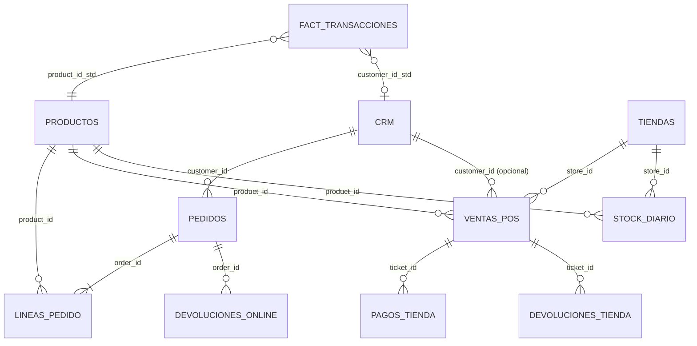

# El universo de datos

FraSoHome tiene cinco dominios de datos. Todos comparten las mismas claves de negocio (`customer_id`, `product_id`, `store_id`, `order_id`, `ticket_id`, `employee_id`) y, donde un dominio usa sus propios códigos, una [tabla puente](../datos/relaciones/README.md) los traduce sin tocar los ficheros originales.

*Diagrama editable: [`universo-datos.drawio`](../diagramas/universo-datos.drawio).*

## Los cinco dominios

| Dominio | Qué cuenta | Ficheros | Detalle |
| --- | --- | ---: | --- |
| Retail omnicanal | Clientes, catálogo, tiendas, pedidos online, tickets, pagos, devoluciones, stock y la *fact table* integrada | 11 | [retail_omnicanal](../datos/retail_omnicanal/README.md) |
| Marketing de precisión | Campañas, contactos, cupones, navegación web/app, identidad, voz del cliente, costes, afinidad local y creatividades | 17 | [marketing_precision](../datos/marketing_precision/README.md) |
| People Analytics | HRIS, movimientos, clima, desempeño, formación, absentismo, horas extra, salarios y entrevistas de salida | 19 | [people_analytics](../datos/people_analytics/README.md) |
| Conocimiento para RAG | 10 documentos internos, 7 CSV resumidos para Dataverse y 2 juegos de evaluación | 19 | [rag_copilot_studio](../datos/rag_copilot_studio/README.md) |
| Relaciones | Alias de tiendas, productos y empleados entre dominios y resultado de los checks de coherencia | 6 | [relaciones](../datos/relaciones/README.md) |

## El núcleo retail

`fact_transacciones.csv` ya trae una versión integrada (una fila por línea de venta o devolución, con flags de normalización) para las demos que no quieren empezar desde cero. Los notebooks del [escenario 02](../escenarios/02-fabric-preparacion-datos/README.md) la reconstruyen paso a paso.

## Del origen al consumo

*Diagrama editable: [`arquitectura-datos.drawio`](../diagramas/arquitectura-datos.drawio).*

## Qué demo usa qué datos

| Escenario | Retail | Marketing | People | RAG | Relaciones |
| --- | :---: | :---: | :---: | :---: | :---: |
| [01 · Empresa con silos](../escenarios/01-empresa-con-silos/README.md) | ● | ● | ● | ● | ● |
| [02 · Fabric](../escenarios/02-fabric-preparacion-datos/README.md) | ● | | | | |
| [03 · SQL](../escenarios/03-sql-raw-core-analytics/README.md) | ● | ● | ● | ● | ● |
| [04 · Analítica de ventas](../escenarios/04-analitica-ventas-ml/README.md) | ● | ● | | | |
| [05 · Marketing de precisión](../escenarios/05-marketing-precision/README.md) | ● | ● | | | |
| [06 · People Analytics](../escenarios/06-power-bi-people-analytics/README.md) | | | ● | | ○ |
| [07 · Copilot Studio](../escenarios/07-copilot-studio-rag/README.md) | | | | ● | ○ |
| [08 · Fabric IQ](../escenarios/08-fabric-iq-ontologia/README.md) | ● | ● | | | |
| [09 · Interpretabilidad GenAI](../escenarios/09-genai-interpretabilidad/README.md) | ● | ● | | ● | |
| [10 · Agentes Foundry](../escenarios/10-agentes-foundry/README.md) | ○ | ○ | | | |

● imprescindible · ○ opcional

La auditoría de coherencia entre dominios está en [datos/coherencia.md](../datos/coherencia.md).
